# Building a Self-Service ML Platform on Kubernetes with Ray, on a Laptop

> A case study of a working platform. Every phase is built, and every number in this article was
> measured on the same machine: a 2-core, 15 GB, no-GPU laptop.

---

ML teams that share a cluster usually hit the same four walls. Running distributed training means
writing Kubernetes YAML and learning Ray internals. A preempted or crashed worker throws away hours
of training. One team's large sweep eats all the capacity and blocks everyone else. And nobody can
say how long a job waited, what it used, or what it cost.

The answer described here is a **self-service platform**: a team hands over a script and a few
resource requirements, and the platform handles scheduling, fault tolerance, isolation, and
visibility. Teams submit training or inference jobs through a small API (`rkp submit ...`), each job
runs on Kubernetes with Ray in its own namespace, checkpoints so it survives crashes, retries
failures, and scales inference with load. All of it runs on the laptop above.

The stack: kind, KubeRay, Ray Train / Ray Serve, PyTorch, FastAPI, SQLite, Prometheus, Grafana, uv,
and GitHub Actions. The core ideas are one RayCluster per job, namespace-per-team quotas,
checkpoint-first training, and metrics computed from the job registry rather than from live
Kubernetes objects. The whole thing must fit inside roughly 3 CPUs and 7 GiB of RAM, and it just
about does: training peaks at 6.9 GiB, and turning monitoring on during training tips it to 7.01, which
is why monitoring stays off for training runs.

---

## The problem

Shared-cluster ML work breaks down into four familiar pain points:

1. **Friction.** Distributed training demands YAML and Ray knowledge before any science happens.
2. **Fragility.** A crash mid-training discards hours of work with no recovery path.
3. **Noisy neighbours.** One team's sweep starves everyone else.
4. **Opacity.** Nobody can report wait time, usage, or cost after the fact.

The goal is straightforward: a platform that takes the scheduling, fault tolerance, isolation, and
visibility off the team's plate, and proves, with tests and measured numbers, that it actually
does so.

## Goals and constraints

| Goal | How it's met |
|---|---|
| Self-service submission | FastAPI + Python SDK/CLI; users never touch Kubernetes YAML |
| Distributed training | Ray Train `TorchTrainer` across multiple workers |
| Survive failures | Per-epoch checkpoints, worker-level and job-level retries |
| Fair multi-tenancy | Namespace + `ResourceQuota` per team |
| Elastic inference | Ray Serve autoscaling on in-flight requests |
| Visibility and cost | Prometheus metrics, Grafana dashboard, cost-per-team report |
| GPU awareness | Ray custom resources simulate GPU scheduling locally |

The hard constraint is the hardware: an i7-7500U (2 cores / 4 threads), 15 GB RAM, no GPU. That
single fact shaped most of the decisions:

- A **single-node kind cluster**: no worker nodes, no multi-node scheduling to demo or pay for.
- **One Ray cluster at a time.** Training *or* serving, not both, unless a demo specifically needs
  multi-tenancy.
- A **tiny default model** (`prajjwal1/bert-tiny`, about 4M parameters) so a training iteration
  stays under 10 minutes. DistilBERT exists as an opt-in profile.
- A **stripped-down monitoring stack** (~0.3 GB idle) that can be torn down before long runs.
- Even the Ray head's autoscaler monitor was audited: heads start with `--no-monitor` because
  worker groups are fixed-size, which saves ~115 MB per head that nothing was using. A tiny job's
  head still needs ~1.4 GB; that is the floor.

The peak, measured without page cache, was 6.9 GiB for training, 7.01 GiB with monitoring on, and
6.84 GiB for the full end-to-end test suite (which briefly runs three small clusters at once during
the GPU test). The budget was ~7 GiB.

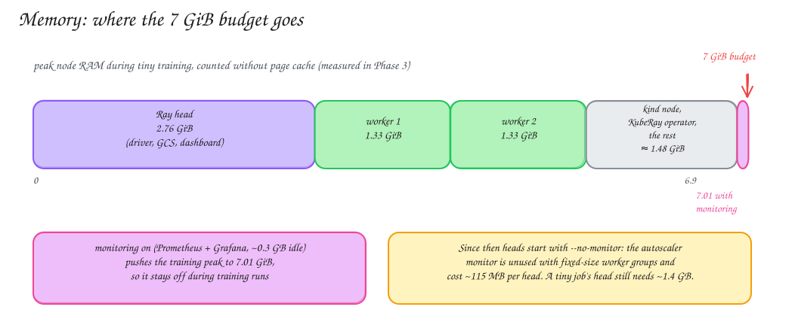

The breakdown explains why the budget is tight. The Ray head is the single biggest line item, larger
than both training workers combined, because it carries the driver, the Global Control Store, the
dashboard and its agents whether the job is tiny or not. That is a fixed cost per Ray cluster, and it
is why the platform runs one cluster at a time on this machine: a second job is not "one more model",
it is another ~1.4–2.8 GiB head.

Measuring memory honestly took some care. A container's raw memory usage includes the kernel's page
cache, which balloons when the dataset is read and is reclaimable, so it overstates real pressure. The
numbers here are `memory.current − active_file − inactive_file` from the node's cgroup: memory that
actually has to fit, not cache the kernel would hand back under pressure.

## Architecture

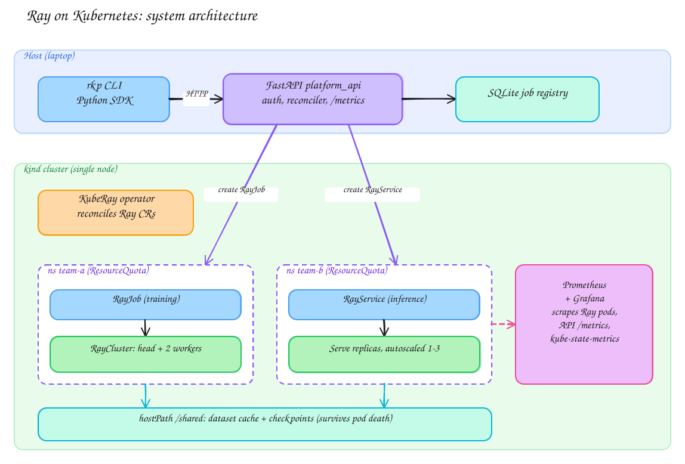

The platform is a small set of components, each with one job:

- **`rkp` CLI / SDK**: a thin HTTP client exposing `submit`, `status`, `logs`, `cancel`, `list`,
  `cost`, and `serve` commands.
- **platform_api (FastAPI)**: maps an API key to a team and namespace, builds Ray custom resources
  from a validated `JobSpec`, ships the user's code in a ConfigMap, and serves `/metrics` and
  `/cost`.
- **Admission**: checks each job or service against the team's `ResourceQuota` *before* creating
  anything. A job that doesn't fit waits in a per-team queue rather than producing Pending pods; a
  service gets a 409 instead.
- **Job registry (SQLite)**: keeps job history after the custom resources are deleted, and is the
  source of queue-time and cost metrics.
- **Reconciler**: a 5-second loop that syncs RayJob status into the registry with timestamps, keeps
  driver logs, deletes finished RayJobs, and admits queued jobs.
- **KubeRay operator**: turns `RayJob` / `RayService` resources into Ray head and worker pods and
  tears them down.
- **Team namespaces**: each team gets a `ResourceQuota` (CPU, memory, simulated GPU) and a
  `LimitRange`.
- **`/shared` hostPath**: dataset cache and checkpoints that outlive any pod.
- **Prometheus + Grafana**: optional monitoring surfacing Ray metrics, API metrics, and quota usage.

Two structural choices deserve emphasis. First, the API (not the user) creates every Kubernetes
object, and the RayJob is the root of everything a job owns: the code ConfigMap carries an owner
reference to its RayJob, and KubeRay owns the RayCluster and the submitter it creates. So when the
reconciler deletes a finished RayJob, everything downstream is garbage-collected by the cluster
itself. Second, nothing durable lives in Kubernetes: CRs are working state, and the registry
is the record. That split is what makes queue-time and cost metrics possible after the CRs are gone.

## How a job flows

A real run of the Phase 2 smoke test tells the story:

```console
$ rkp submit --team team-a workloads/hello.py
0e639b3a
[    0s] SUBMITTED
[    2s] PENDING
[   42s] RUNNING
[   62s] SUCCEEDED  (Job finished successfully.)
$ rkp logs 0e639b3a | grep -v '^20'
task 0 ran on rkp-0e639b3a-vqh2s-cpu-worker-z8ngf
task 1 ran on rkp-0e639b3a-cpu-worker-27wsm
hello from rkp
$ rkp cancel <id>          # deletes the RayJob, state → CANCELLED
$ rkp status <id> -t team-b
error: HTTP 403: job <id> belongs to another team
```

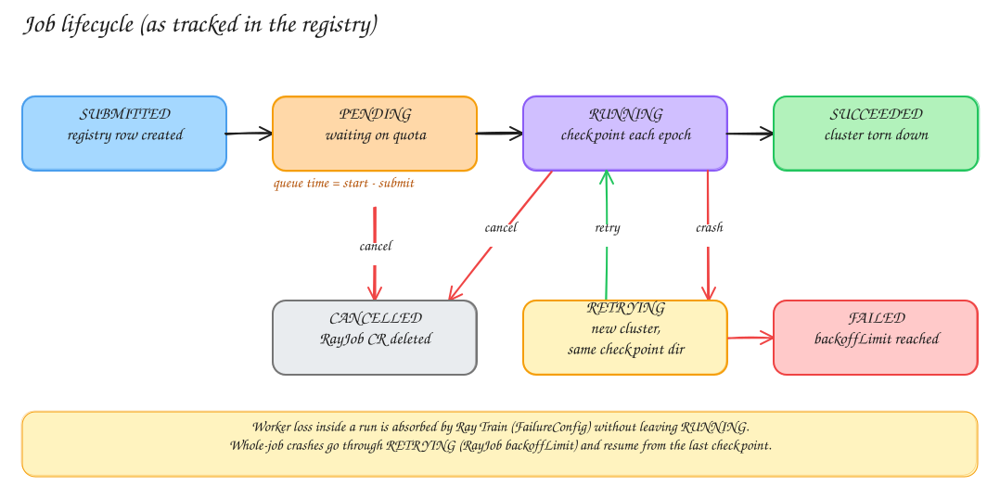

Step by step:

1. The CLI sends the spec to `POST /jobs` with the team's API key.
2. The API resolves the key to a team and namespace, **never from the request body**, so a caller
   cannot place work in someone else's namespace by asking nicely. It validates the `JobSpec` and
   writes a `SUBMITTED` row.
3. The API creates a `RayJob` in the team's namespace. KubeRay starts a RayCluster (head plus
   workers), runs the entrypoint, then shuts the cluster down (`shutdownAfterJobFinishes`).
4. The reconciler records each state change. Queue time is defined as `started_at − submitted_at`,
   using Ray's own start timestamp (not an API-side guess), so it reflects real scheduling delay.
5. When the job ends, the reconciler copies the driver logs into SQLite and deletes the RayJob;
   owner references remove the cluster, the submitter and the code ConfigMap.

Most of the 40 seconds spent in PENDING is pod start-up for the head and workers on two cores. That
is the price of the one-cluster-per-job decision, and it is paid once per job, not per epoch.

## Distributed training and fault tolerance

The training workload is a sentiment classifier on an Amazon reviews subset (about 4k train / 1k
eval). `TorchTrainer` runs two workers on the CPU `gloo` backend, with `torch.set_num_threads(1)`
per worker so they don't fight over two physical cores.

```console
$ make data      # once: download + tokenize; training pods never hit the network
$ rkp submit --team team-a workloads/train --script train.py -- --profile tiny --epochs 2
[    0s] SUBMITTED
[    6s] PENDING
[   40s] RUNNING
[  146s] SUCCEEDED  (Job finished successfully.)
$ rkp logs <id> | grep 'rank 0'
[rank 0] {'epoch': 1, 'train_loss': 0.5165, 'eval_loss': 0.3447, 'eval_accuracy': 0.851, 'epoch_seconds': 35.8}
[rank 0] {'epoch': 2, 'train_loss': 0.2303, 'eval_loss': 0.3455, 'eval_accuracy': 0.853, 'epoch_seconds': 35.7}
```

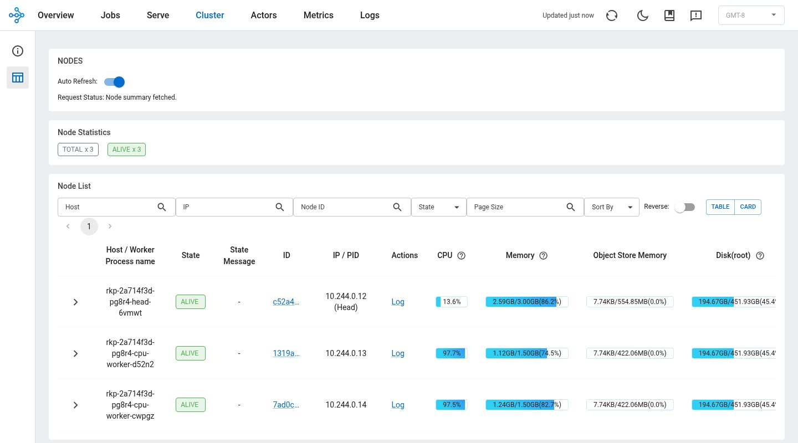

Mid-run, the Ray dashboard shows both workers at about 97% CPU each, with the head holding the
driver: two physical cores, two busy workers, nothing left on the table.

Where does the time go? Breaking one recorded run down from the registry timestamps and the
per-epoch log lines:

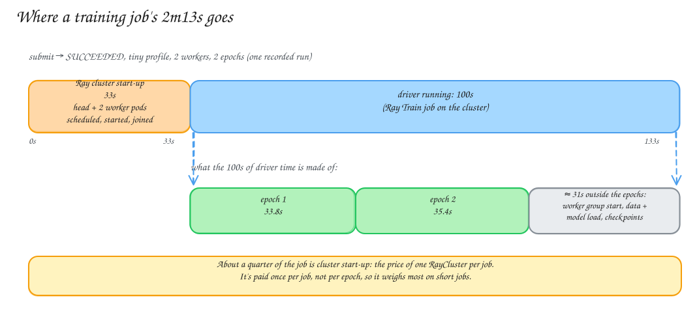

About a quarter of the job is Ray cluster start-up, before any user code runs. That's the bill for
one RayCluster per job, and it's the main argument for the alternative, a long-lived shared cluster.
On this hardware the trade is worth it: the start-up buys complete isolation and nothing idling
between jobs. On a busy production cluster with short jobs the balance shifts, and warm pools or a
shared cluster with per-team Ray namespaces start to look better.

Fault tolerance has two layers:

| Failure | Handled by | Effect |
|---|---|---|
| A worker pod dies mid-epoch | Ray Train `FailureConfig(max_failures=3)` | Worker group restarts, training resumes from the last checkpoint, job stays RUNNING |
| The whole job crashes | RayJob `backoffLimit` | New cluster, same `storage_path`, resumes from the checkpoint |
| A user cancels | API deletes the RayJob CR | Operator tears down all pods; state becomes CANCELLED |

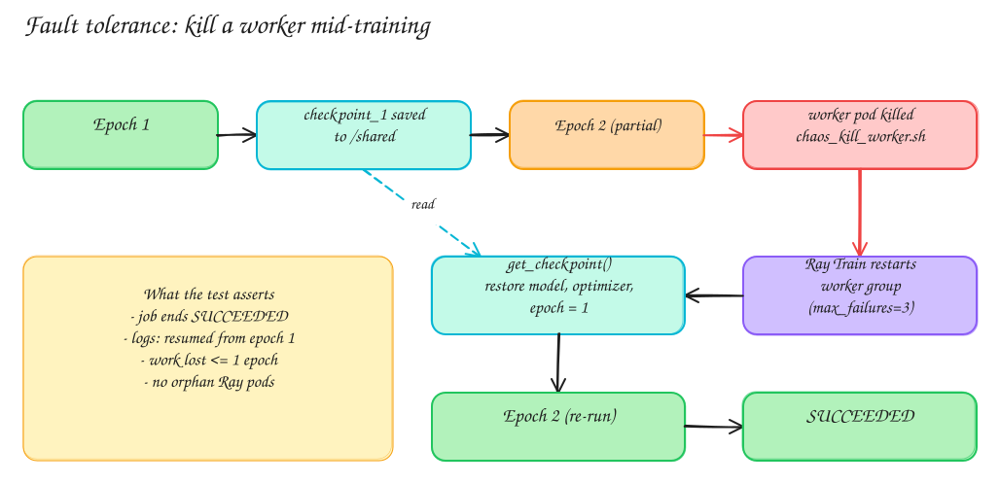

The detail that makes this work is that the training loop always starts with
`ray.train.get_checkpoint()` and restores the model, **optimizer**, and **epoch counter**, not just
the weights. Restoring only the weights would silently rewind the learning-rate schedule and re-run
finished epochs. Done this way, a crash costs at most one epoch. The end-to-end suite checks the
mechanism: it kills a worker pod once the first checkpoint exists and asserts that the job resumes
from it and succeeds. A recorded chaos run measured the cost: the kill landed during epoch 2, rank 1
saw a gloo "connection reset", Ray Train logged "Error count: 1 (max allowed: 3)", restarted the
worker group from the epoch-1 checkpoint, and finished at 85.6% accuracy in about 2m50s, versus
~2m27s without the kill. That's the partial epoch plus a restart, which is exactly the design claim.

## Admission control and multi-tenancy

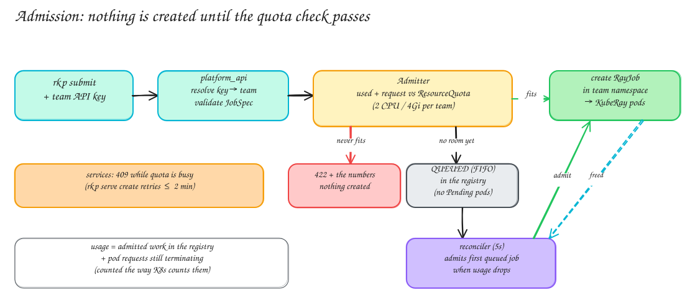

Isolation and fairness are two different problems, and the platform solves both at the API layer
rather than in the scheduler.

**Isolation.** Every API call is scoped to the namespace of the caller's key, so team-b gets a 403
on team-a's jobs. When the API runs in-cluster, RBAC limits its ServiceAccount to `ray.io` resources
in `team-*` namespaces, so even a compromised API couldn't touch anything else. One caveat: in this
laptop setup the API runs on the host with the developer's kubeconfig, so that RBAC boundary is
verified by `kubectl auth can-i --as` checks in the end-to-end suite rather than exercised by the
running API.

**Fairness.** Each team has a hard `ResourceQuota` (2 CPU / 4 GiB of requests), and the node is
sized so the sum of the quotas is no more than allocatable. The interesting part is *how* the quota
is enforced. The Admitter checks `used + new request` against the quota **before** creating
anything:

- A job that fits is admitted immediately and becomes a RayJob.
- A job that doesn't fit **yet** is stored `QUEUED` in the registry: a FIFO per-team queue with no
  Kubernetes objects involved, hence no Pending pods squatting on the cluster. The reconciler
  admits the first queued job as soon as usage drops.
- A job bigger than the team's whole quota can never fit, so it gets a 422 **with the numbers** and
  nothing is created.
- A service gets a 409 while the quota is busy; `rkp serve create` retries it every 3 seconds for up
  to two minutes precisely because a finished job's pods take a few seconds to terminate and hand
  quota back.

Usage is counted the way Kubernetes itself counts pods for quota: admitted work in the registry,
plus the requests of pods that are still terminating for finished jobs or deleted services. That
closes the hand-over gap: a finished job whose head pod is still terminating keeps its quota until
the pod is really gone, so two jobs never briefly share one team's allocation. (This wasn't the
original design; how the gap was found is in "Lessons learned" below.)

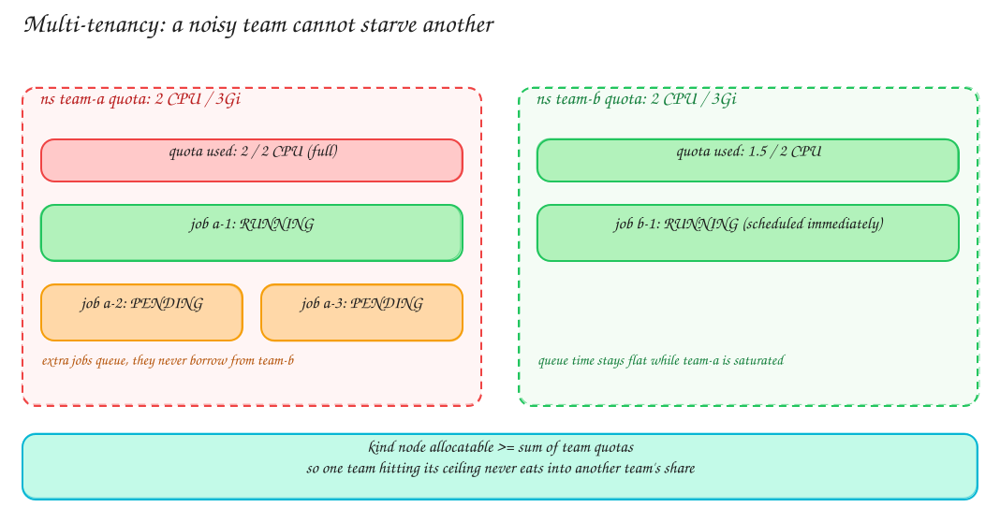

The noisy-neighbour demo floods team-a, then submits a single team-b job. Measured: team-a's own
queue time went 34s → 137s → 244s as its queue backed up behind its quota, while team-b's stayed at
34s (the same as on an idle cluster), and its job succeeded. The flood cost the attacker's team
its own latency and nobody else's. The natural next step is [Kueue](https://kueue.sigs.k8s.io/) for
proper admission queues, fair sharing and preemption.

## Inference with autoscaling

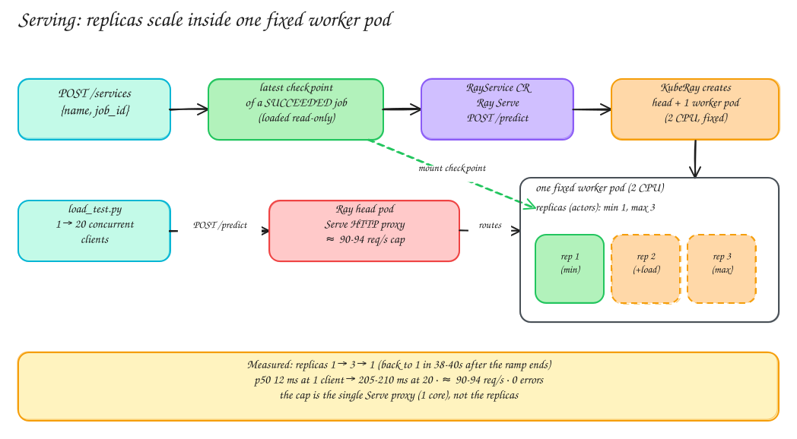

`POST /services {"name": "sentiment", "job_id": "<training job>"}` serves the latest checkpoint of a
SUCCEEDED training job as a `RayService` with
`autoscaling_config: {min_replicas: 1, max_replicas: 3, target_ongoing_requests: 2}`. The
checkpoint is loaded read-only; the replicas scale inside one fixed 2-CPU worker pod, and the
service counts against the team quota like any other work.

A load test ramping from 1 to 20 concurrent clients showed replicas going **1 → 3** under load and
back to 1 roughly 38 seconds after the load stopped. p50 latency was 12 ms with 1 client and
205–210 ms with 20. Throughput was capped at about 90–94 req/s, and the interesting finding is
*where* the cap is: the single Serve HTTP proxy, running at 100% of one core. The replicas were not
saturated; the front door was. During a 20-client burst the proxy actor sat at 100% of a core and the
head container at 98% of its 1-CPU limit, while each replica used only 27–36%. Throughput stayed at
roughly 80–95 req/s whether one replica or three were running, so the extra replicas absorbed queued
requests rather than adding capacity. bert-tiny inference takes a few milliseconds, so a single
Python proxy saturates first. Making replicas count would take heavier per-request work (DistilBERT, or
`@serve.batch`), several proxies behind a real load balancer instead of a port-forward, and a head with
more than one CPU. A second run on a different day reproduced the result end-to-end: 1 → 3 → 1 (down
after 40 s), p50 205 ms at 20 clients, ~94 req/s, zero errors.

| Idle: 1 replica | Under 20 clients: 3 replicas |
|---|---|
| 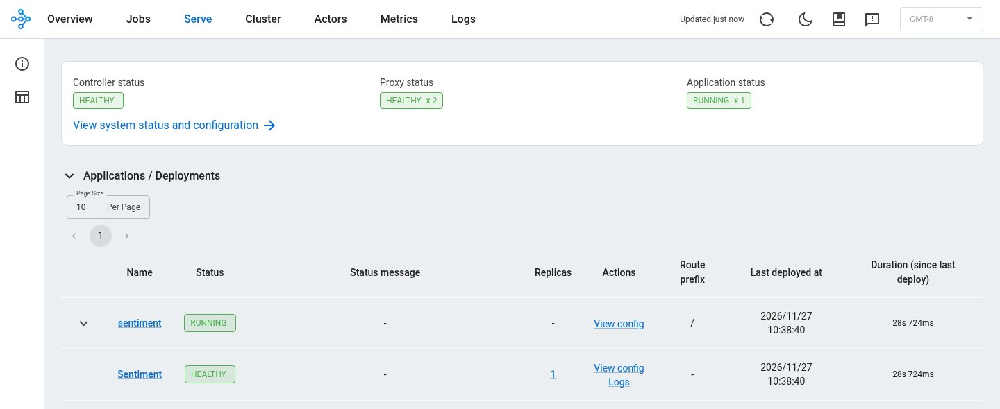 | 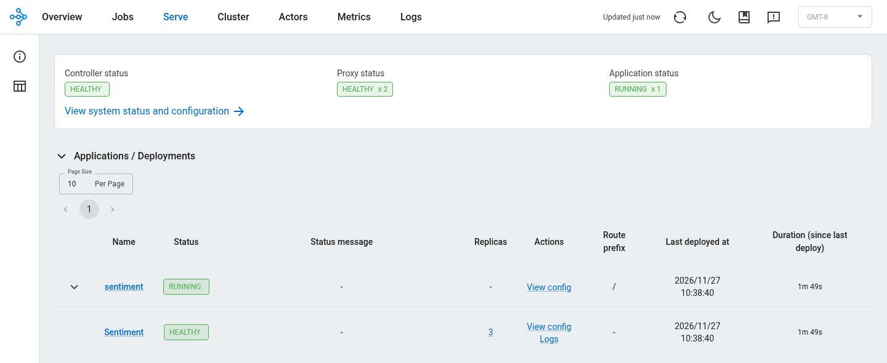 |

Creating a service takes 30–45 seconds from `POST /services` to RUNNING, most of it KubeRay
starting the head and worker pods, the same per-job start-up cost as training, paid once per
service.

## Observability and cost

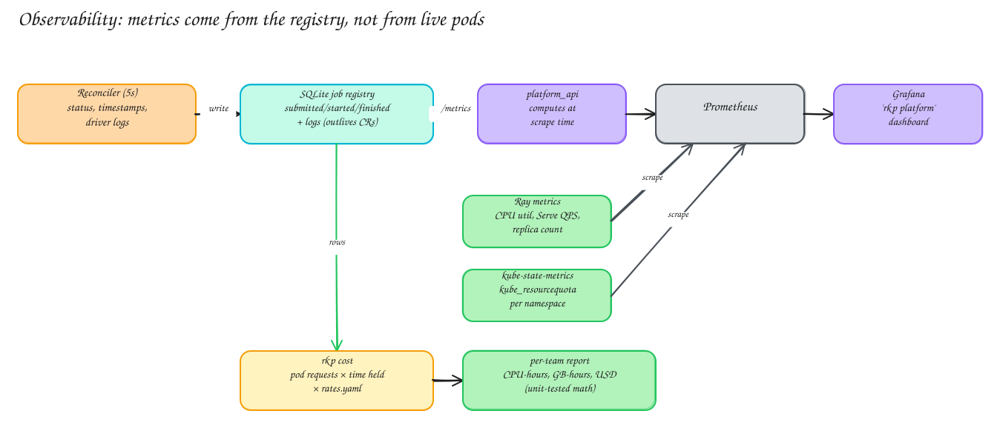

| Metric | Source | Question it answers |
|---|---|---|
| `rkp_jobs_total{team,state}` | API | How many jobs succeed or fail per team? |
| `rkp_job_queue_seconds{team}` | API (registry timestamps) | Is a team starved? |
| `rkp_job_runtime_seconds{team}` | API | How long do jobs actually run? |
| `ray_node_cpu_utilization`, Serve QPS / replicas | Ray | Are workers busy, and is autoscaling working? |
| `kube_resourcequota{namespace}` | kube-state-metrics | How close is each team to its quota? |

The API's metrics are computed from the job registry at scrape time (a deliberate choice), since the
custom resources are deleted after jobs finish. Prometheus scrapes the API, Ray and
kube-state-metrics; Grafana shows the `rkp platform` dashboard. After the noisy-neighbour demo, the
dashboard shows team-a's queue time stepping 34s → 141s → 246s while team-b's stays at 33s:

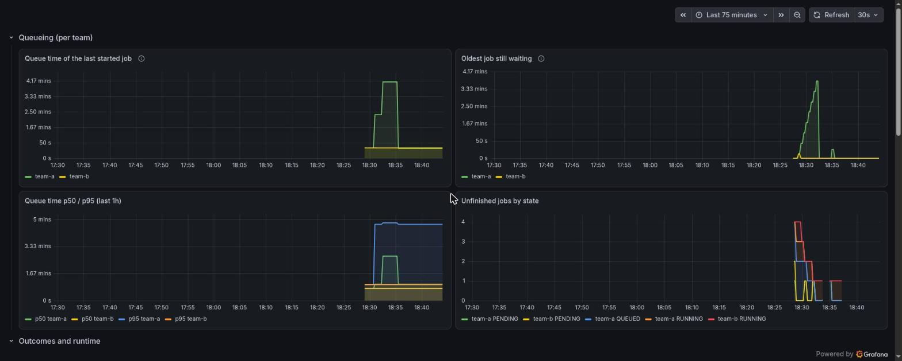

**Cost** is where the registry earns its keep. `rkp cost --since 7d` computes pod requests × time
held (for a job, from driver start to finish; for a service, from create to delete) multiplied
by rates from a config file. From the recorded quickstart hour:

```console
TEAM        JOBS  SVCS  CPU-HOURS   GB-HOURS       COST
team-a         2     2      0.089      0.204     0.0025 USD
team-b         0     0      0.000      0.000     0.0000 USD
total                       0.089      0.204     0.0025 USD
```

The arithmetic is unit-tested against registry rows, so the number an administrator bills a team
with is the same one the tests assert.

**GPU awareness** is simulated honestly: there is no GPU on the laptop, so the node advertises a
fake one (`example.com/gpu: 1`, exactly like a device plugin would), and `JobSpec.gpus: 1` adds a
`gpu-sim` worker that holds it and starts Ray with a custom resource `{"sim_gpu": 1}`. The
scheduling behaviour is real even though the device is not: team-b's GPU job sat Pending for
**150 seconds** (`Insufficient example.com/gpu`, shown in `rkp status`) while team-a held the only
GPU, and team-b's CPU job finished in 36s meanwhile. What the demo shows is the *contention
mechanics*: exclusive device scheduling, quota accounting per team, and a status message that
tells the user why the job is waiting.

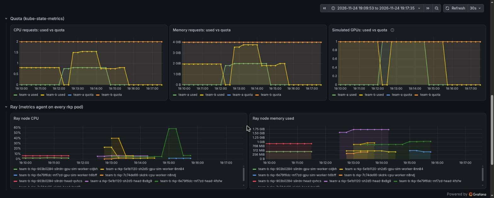

## Key decisions and trade-offs

| Decision | Alternative | Why |
|---|---|---|
| **One RayCluster per job** (RayJob) | One long-lived shared Ray cluster | Clean isolation, per-job sizing, nothing idling; at the cost of cluster start-up per job |
| **API in front of K8s** | Give teams kubectl access | Enforces team scoping, hides YAML, keeps history |
| **SQLite registry** | Read state from custom resources only | Resources are deleted after jobs finish; queue time and cost need durable timestamps |
| **hostPath checkpoints** | MinIO / S3 | Equivalent on a single node and saves ~500 MB RAM; production would be S3 / GCS |
| **`bert-tiny` default** | DistilBERT | The platform mechanics are the point, and it keeps iteration under 10 minutes on 2 cores |
| **Pinned everything** | Latest tags | Reproducible builds; a test fails on any floating version |

None of these are free. One-cluster-per-job costs 30–40 seconds of start-up per job; the API in
front of Kubernetes means the platform team owns every failure mode of the API; SQLite caps
concurrent writers at one. They are all reasonable *for this hardware and this team*, and the
production section below is the list of exactly which ones to revisit and when.

## Testing: how the claims are verified

Every number quoted above comes from a test or a recorded run, and the test suite is layered so
that the cheap layers run everywhere and the expensive ones run only where they must:

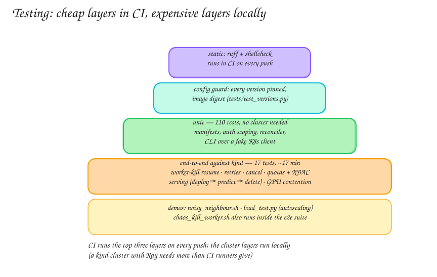

| Layer | What | Where | Status |
|---|---|---|---|
| Static | ruff lint + format, shellcheck | `make lint`, CI | ✅ |
| Config guard | Every version pinned, node image pinned by digest | `tests/test_versions.py` | ✅ |
| Unit | JobSpec → RayJob manifest, auth and team scoping, reconciler, CLI (fake K8s client) | `make test` | ✅ |
| Integration | Submit / status / logs / cancel against kind | `make test-k8s` | ✅ |
| Chaos | Kill a worker mid-epoch, assert resume from checkpoint | `scripts/chaos_kill_worker.sh`, run by `make test-k8s` | ✅ |
| Tenancy | Noisy neighbour: team-b unaffected by team-a saturation, RBAC `can-i` checks | `scripts/noisy_neighbour.sh`, `make test-k8s` | ✅ |
| Load | Serve autoscaling 1 → 3 replicas under ramped load | `scripts/load_test.py`, run as a recorded demo (the serve e2e test covers deploy → predict → delete) | ✅ |

That is 110 unit tests with no cluster needed and 17 end-to-end tests against kind in about 17
minutes. CI (GitHub Actions) runs the static and unit layers on every push; the cluster layers run
locally, because a kind cluster with Ray needs more than CI runners comfortably provide. The one
deliberately *not* automated claim is latency: the load test records it, but asserting hard p50
thresholds on a 2-core laptop that is also running the cluster would be testing the laptop, not the
platform.

## Results

All numbers are from real runs on the laptop (2 cores / 4 threads, 15 GB, no GPU; single-node kind;
`bert-tiny`):

| Area | Measure | Result |
|---|---|---|
| Training | `tiny`, 2 workers, 2 epochs | ~35s per epoch; submit → SUCCEEDED in 2m13s–2m27s |
| Training | Eval accuracy (1k held-out reviews) | **85.3%**, identical across 3 runs |
| Fault tolerance | Worker pod killed mid-epoch | Restarted from the epoch-1 checkpoint; only the partial epoch lost (85.6% in ~2m50s) |
| Fault tolerance | Job that always crashes, `retries: 2` | FAILED after 3 attempts, no pods left |
| Fault tolerance | Cancel during training | CANCELLED, all pods gone |
| Multi-tenancy | Team-b queue time while team-a floods its quota | **34s**, the same as idle; team-a queued 34s → 137s → 244s |
| Multi-tenancy | Job bigger than the team's whole quota | 422 with the numbers, nothing created |
| GPU (simulated) | Team-b GPU job while team-a holds the only GPU | Pending **150s**; team-b's CPU job finished in 36s |
| Serving | `rkp serve create` → RUNNING | 30–45s |
| Serving | Replicas under a 1 → 20 client ramp | 1 → 3, back to 1 in 38–40s, 0 errors |
| Serving | Latency / throughput | p50 12 ms (1 client) to 205–210 ms (20 clients); ~90–94 req/s |
| Cost | `rkp cost` | CPU-hours, GB-hours and cost per team from pod requests × time held; unit-tested |
| Footprint | Peak node RAM (without page cache) | 6.9 GiB training; 7.01 GiB with monitoring; 6.84 GiB for the full e2e suite; budget ~7 GiB |
| Getting started | Cluster up → train → serve → predict → cost | ~6 minutes after the one-time image build |
| Tests | Unit / end-to-end | 110 unit tests + 17 end-to-end tests in ~17 min |

## Running it yourself

**Prerequisites:** Linux/macOS, Docker, [uv](https://docs.astral.sh/uv/), about 8 GB free RAM.

One-time setup (the image build is the slow step; `make data` is the only step that touches the
network):

```bash
git clone git@github.com:Ridzzz0Alam/ray_on_kubernetes.git && cd ray_on_kubernetes
make tools sync   # pinned kind / kubectl / helm → ~/.local/bin, Python 3.12 env from uv.lock
make image        # Ray runtime image with CPU torch baked in
make data         # tokenized data subset + bert-tiny → .shared/data
```

Bring the platform up (3m07s measured: kind cluster, KubeRay operator, image load, team namespaces
and quotas):

```bash
make up teams keys   # keys: dev API keys for team-a / team-b in config/ (git-ignored)
make api             # platform API on 127.0.0.1:8000; leave it running, use a second terminal
```

Train, serve, predict and see the cost (176s measured):

```bash
JOB=$(uv run rkp submit -t team-a workloads/train --script train.py -- --profile tiny --epochs 1)
uv run rkp logs $JOB -t team-a | grep -F '[rank 0] {' | tail -1
uv run rkp serve create sentiment $JOB -t team-a
kubectl --context kind-rkp -n team-a port-forward svc/rkp-svc-sentiment-serve-svc 8001:8000 &
curl -s localhost:8001/predict -d '{"text": "Great product, works perfectly."}'
uv run rkp cost --since 1h
uv run rkp serve delete sentiment -t team-a
make down            # delete the cluster (stop make api with Ctrl-C)
```

What you should see at the end:

```console
{"predictions":[{"label":"positive","score":0.9262}],"checkpoint":"checkpoint_2026-11-27_10-08-24.977867"}
```

Everything is pinned: kind v0.33.0 (Kubernetes v1.37.0), kubectl v1.37.2, Helm v4.3.1, KubeRay
1.7.2, Ray 2.59.0 (Python 3.12). A test fails if any of those float. Recorded demos with raw
output: [serving](docs/demos/serving.md), [multi-tenancy](docs/demos/multi-tenancy.md),
[observability](docs/demos/observability.md), [GPU awareness](docs/demos/gpu-awareness.md).

## Lessons learned: what broke along the way

The finished numbers hide the bugs that got fixed on the way to them. These are the ones worth
knowing about if you build something similar.

**1. Two sources of truth for quota disagree for a few seconds.** The Admitter originally freed a
job's quota the moment the reconciler deleted its RayJob. Kubernetes doesn't see it that way: the
job's pods take a few seconds to terminate, and the `ResourceQuota` keeps counting them until they're
gone. So the next job was admitted by the API and then had its pods refused by Kubernetes with
"exceeded quota" events (`used: requests.memory=4040Mi, limited: 4Gi`). On the Grafana dashboard it
showed up as "used" briefly touching the 4 GiB line.

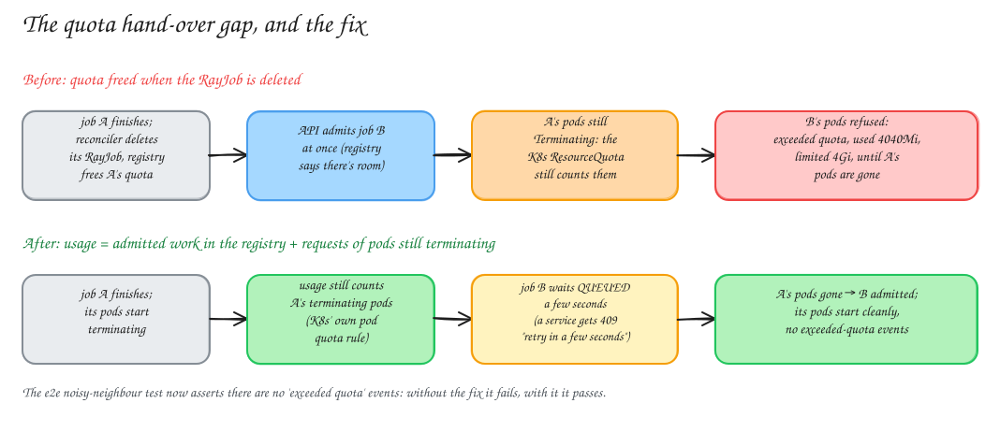

The fix was to stop pretending the API knows better than the cluster. Usage is now the registry's
admitted work *plus* the requests of pods still terminating for finished work, using the same rule
Kubernetes' own pod quota evaluator uses: a pod stops counting once it has Succeeded or Failed, or is
past its deletion grace period. The noisy-neighbour end-to-end test now asserts that no "exceeded
quota" events happen. Without the fix it fails, and with it it passes. The visible side effect is the
409 "retry in a few seconds" that `rkp serve create` retries.

**2. A worker that's slightly too small doesn't fail, it hangs.** A Ray worker node's own processes
(raylet, agents) take about 0.45 GB before any user code runs. At a 512Mi limit, a worker that
actually ran tasks got killed by Ray's memory monitor, which retried the task, which got killed again.
The job showed RUNNING indefinitely. Nothing crashed, so nothing alerted. Workers that run tasks now
get at least 640Mi. The general lesson: on a tight memory budget, measure the framework's fixed cost
per process before sizing anything.

**3. Not everything can be switched off.** Starting heads with `--no-monitor` saved ~115 MB per head,
because the autoscaler monitor does nothing with fixed-size worker groups. The obvious next trim, the
unused Ray Client server (~112 MB), can't be done the same way: `--ray-client-server-port=0` crashes
the head, because Ray only accepts ports 1024–65535. Some fixed costs are simply the price of the
framework.

**4. Patching a node's capacity isn't instant.** The simulated GPU is added by patching the node's
status capacity, as a device plugin would. Allocatable only catches up on the kubelet's next status
sync, 10–30 seconds later, and anything scheduled before that sees zero GPUs. `make gpu-sim` now
waits until allocatable shows the GPU before returning.

**5. The obvious metric can be the wrong one.** Summing `ray_serve_deployment_replica_healthy`
undercounted the replicas, so the dashboard uses `ray_serve_autoscaling_target_replicas` for the
replica count instead. Likewise, queue time uses Ray's own job start and finish timestamps rather than
the moment the reconciler noticed a change, so it stays accurate even for jobs shorter than one
5-second poll.

## What production would change

The laptop-forced choices are explicit, and each has a named successor:

- **S3/GCS checkpoints**: the hostPath is only equivalent on a single node; on a multi-node
  cluster it would silently break.
- **OIDC instead of API keys**: real users have real identities; keys don't survive them.
- **Postgres instead of SQLite**: one writer is fine for one API pod, and nothing else.
- **A watch-based controller instead of the 5s polling loop**: polling is simple and costs a
  couple of list calls every five seconds; watches scale to thousands of jobs.
- **Kueue with fair sharing and preemption**: the hand-rolled FIFO queue demonstrates the
  semantics but not the fairness policies.
- **Separate CPU/GPU/spot node pools on a managed cluster**: the scheduling, per-team GPU quota
  and "why is it pending" status logic carry over; the simulated pieces get swapped for real ones
  (`nvidia.com/gpu` from the NVIDIA device plugin instead of `example.com/gpu`, Ray's built-in `GPU`
  resource instead of `sim_gpu`, and a CUDA build of the image).

The trade-offs are documented rather than hidden, which is the real point of the exercise.

---

The full design, plan and decision log, session log, and recorded demos (serving, multi-tenancy,
observability, and GPU awareness) accompany the source, along with a quickstart that trains,
serves, and prices a model in about six minutes.
