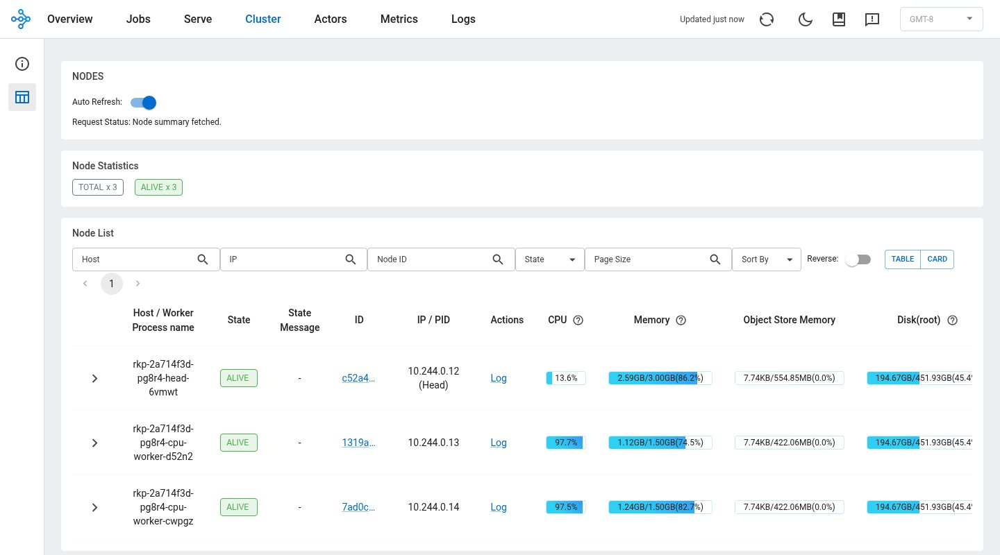
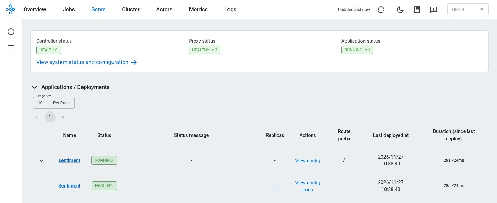
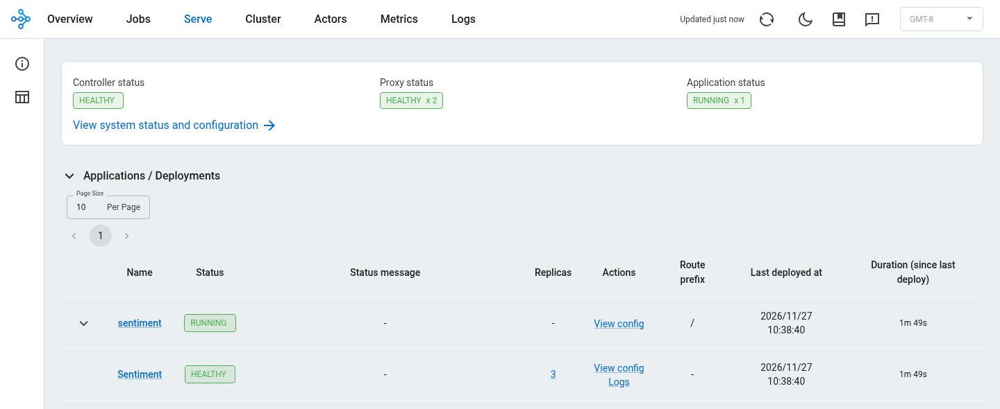
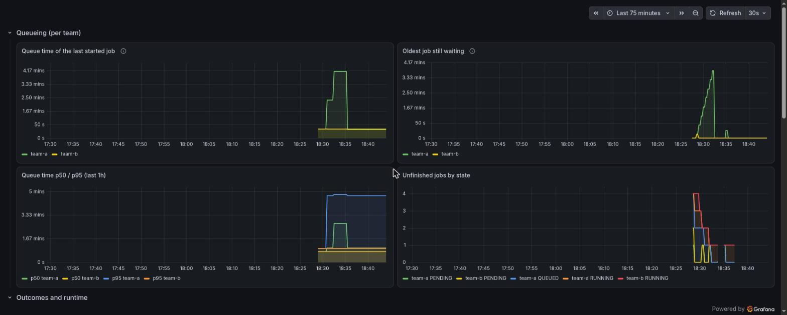
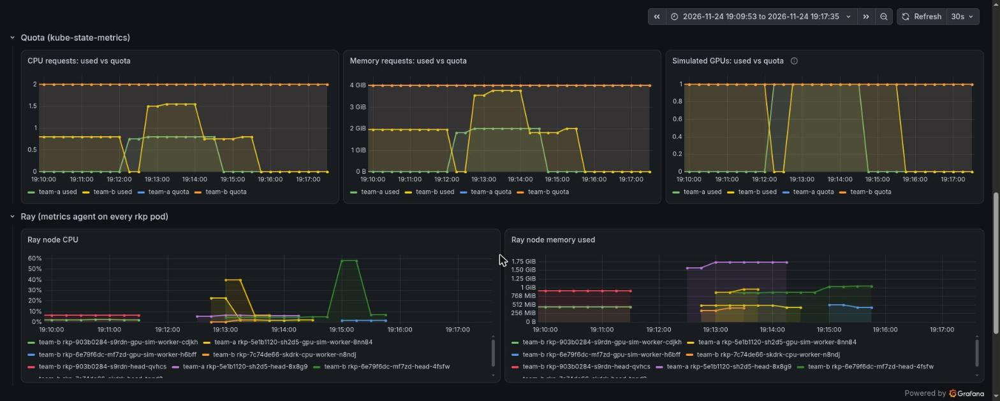

# Ray on Kubernetes: a self-service ML platform

[](https://github.com/Ridzzz0Alam/ray_on_kubernetes/actions/workflows/ci.yml)

> **Case study of a working platform.** All the build phases are done, and every number here was measured on the
> dev laptop. Design detail: [ARCHITECTURE.md](ARCHITECTURE.md) · plan and decision log: [PLAN.md](PLAN.md) ·
> session log: [PROGRESS.md](PROGRESS.md).

## TL;DR

Teams submit ML training or inference jobs through a small API (`rkp submit ...`). The platform runs each job
on Kubernetes with Ray, isolated in the team's own namespace. It checkpoints, survives worker crashes, retries
failures and scales inference with load. All of it runs on a **2-core, 15 GB, no-GPU laptop**.

| | |
|---|---|
| **Stack** | kind · KubeRay · Ray Train / Ray Serve · PyTorch · FastAPI · SQLite · Prometheus · Grafana · uv · GitHub Actions |
| **Core ideas** | one RayCluster per job, namespace-per-team quotas, checkpoint-first training, metrics from the job registry |
| **Constraint** | whole stack ≤ ~3 CPU / ~7 GB RAM |

**Try it:** the [quickstart](#quickstart-about-6-minutes-after-the-one-time-image-build) trains, serves and prices a model in about 6 minutes.

---

## 1. The problem

ML teams that share a cluster usually hit the same problems:

1. **Friction.** Running distributed training means writing Kubernetes YAML and knowing Ray internals.
2. **Fragility.** A preempted or crashed worker throws away hours of training.
3. **Noisy neighbours.** One team's large sweep takes all the capacity and blocks everyone else.
4. **Opacity.** No one can say how long jobs waited, what they used or what they cost.

The goal: a **self-service platform** where a team hands over a script and some resource requirements, and the
platform takes care of scheduling, fault tolerance, isolation and visibility.

## 2. Goals and constraints

| Goal | How it's met |
|---|---|
| Self-service submission | FastAPI + Python SDK/CLI. Users never touch K8s YAML |
| Distributed training | Ray Train `TorchTrainer` across multiple workers |
| Survive failures | Per-epoch checkpoints, worker-level and job-level retries |
| Fair multi-tenancy | Namespace + `ResourceQuota` per team |
| Elastic inference | Ray Serve autoscaling on in-flight requests |
| Visibility and cost | Prometheus metrics, Grafana dashboard, cost-per-team report |
| GPU awareness | Ray custom resources simulate GPU scheduling locally |

**The hard constraint is the hardware:** an i7-7500U (2 cores / 4 threads), 15 GB RAM, no GPU. That shaped
many of the decisions (§9): a single-node cluster, one Ray cluster at a time, a tiny default model
(`bert-tiny`) and a stripped-down monitoring stack.

## 3. Architecture


| Component | Role |
|---|---|
| **`rkp` CLI / SDK** | Thin HTTP client: `submit`, `status`, `logs`, `cancel`, `list`, `cost`, `serve create/status/list/delete` |
| **platform_api** (FastAPI) | Maps the API key to a team and namespace, builds Ray CRs from a validated `JobSpec` and ships the code in a ConfigMap, serves `/metrics` and `/cost` |
| **Admission** | Checks each job or service against the team's `ResourceQuota` before creating anything. A job that doesn't fit yet waits in a per-team queue (no Pending pods). A service gets a 409 instead |
| **Job registry** (SQLite) | Keeps job history after the CRs are deleted. It's the source for queue-time and cost metrics |
| **Reconciler** | 5s loop: syncs RayJob status into the registry with timestamps, keeps the driver logs, deletes finished RayJobs, admits queued jobs |
| **KubeRay operator** | Turns `RayJob` / `RayService` CRs into Ray head and worker pods, and tears them down. Heads start with `--no-monitor` (fixed-size worker groups) |
| **Team namespaces** | `team-a`, `team-b`, … each with a `ResourceQuota` (CPU, memory, simulated GPU) + `LimitRange` |
| **`/shared` (hostPath)** | Dataset cache and checkpoints, which outlive any pod |
| **Prometheus + Grafana** | Optional (`make monitoring`). Ray metrics, API metrics, quota usage from kube-state-metrics |

Editable sources for all diagrams: [`docs/diagrams/*.excalidraw`](docs/diagrams/). Open them at
[excalidraw.com](https://excalidraw.com) or in the VS Code Excalidraw extension.

## 4. How a job flows

A real run of the Phase 2 smoke test:

```console
$ rkp submit --team team-a workloads/hello.py
0e639b3a
[    0s] SUBMITTED
[    2s] PENDING
[   42s] RUNNING
[   62s] SUCCEEDED  (Job finished successfully.)
$ rkp logs 0e639b3a | grep -v '^20'
task 0 ran on rkp-0e639b3a-vqh2s-cpu-worker-z8ngf
task 1 ran on rkp-0e639b3a-vqh2s-cpu-worker-27wsm
...
hello from rkp
$ rkp cancel <id>          # deletes the RayJob, state → CANCELLED
$ rkp status <id> -t team-b
error: HTTP 403: job <id> belongs to another team
```

Options: `--workers`, `--cpu`, `--memory`, `--retries`, `--no-wait`, and script arguments after `--`.
Most of the 42s in PENDING is pod start-up for the head and workers on 2 cores.

1. The CLI sends the spec to `POST /jobs` with the team's API key.
2. The API resolves the key to a team and namespace (never taken from the request body), validates the `JobSpec` and
   writes a `SUBMITTED` row.
3. The API creates a `RayJob` in `team-a`. KubeRay starts a RayCluster (head + workers), runs the entrypoint,
   then shuts the cluster down (`shutdownAfterJobFinishes`).
4. The reconciler records each state change. `queue time = started_at − submitted_at`, using Ray's own start time.
5. When the job ends, the reconciler copies the driver logs into SQLite and deletes the RayJob.
   Owner references remove the cluster, the submitter and the code ConfigMap.


## 5. Distributed training and fault tolerance

The training workload is a sentiment classifier on an Amazon reviews subset (about 4k train / 1k eval).
`TorchTrainer` runs 2 workers on the CPU `gloo` backend, with `torch.set_num_threads(1)` per worker so they
don't fight over 2 physical cores. The default model is `prajjwal1/bert-tiny` (about 4M params), and DistilBERT is opt-in.

```console
$ make data      # once: download + tokenize into .shared/data (~1 min); training pods never hit the network
$ rkp submit --team team-a workloads/train --script train.py -- --profile tiny --epochs 2
[    0s] SUBMITTED
[    6s] PENDING
[   40s] RUNNING
[  146s] SUCCEEDED  (Job finished successfully.)
$ rkp logs <id> | grep 'rank 0'
[rank 0] {'epoch': 1, 'train_loss': 0.5165, 'eval_loss': 0.3447, 'eval_accuracy': 0.851, 'epoch_seconds': 35.8}
[rank 0] {'epoch': 2, 'train_loss': 0.2303, 'eval_loss': 0.3455, 'eval_accuracy': 0.853, 'epoch_seconds': 35.7}
```

Mid-run in the Ray dashboard, both workers are busy at about 97% CPU each, and the head holds the driver:



Fault tolerance has two layers:

| Failure | Handled by | Effect |
|---|---|---|
| A worker pod dies mid-epoch | Ray Train `FailureConfig(max_failures=3)` | Worker group restarts, training resumes from the last checkpoint, and the job stays RUNNING |
| The whole job crashes | RayJob `backoffLimit` | New cluster, same `storage_path`, so it resumes from the checkpoint |
| A user cancels | API deletes the RayJob CR | The operator tears down all pods, and the state becomes CANCELLED |


The key detail is that the training loop always starts with `ray.train.get_checkpoint()` and restores the
model, **optimizer** and **epoch counter**, not just the weights. So a crash costs at most one epoch.

## 6. Multi-tenancy


- **Isolation:** every API call is scoped to the namespace of the caller's key, so team-b gets a 403 on team-a's jobs.
  When the API runs in-cluster, RBAC limits its ServiceAccount to `ray.io` resources in `team-*` namespaces.
- **No starvation:** each team has a hard `ResourceQuota` (2 CPU / 4Gi of requests), and the node is sized so that the sum of
  the quotas is no more than allocatable. The API admits whole jobs against the quota: extra jobs wait `QUEUED` (FIFO),
  and a job bigger than the whole quota gets a 422 with the numbers. Team-b is unaffected.
- **Demo:** `scripts/noisy_neighbour.sh` floods team-a, then submits one team-b job. Measured: team-a's queue time
  went 34s → 137s → 244s, team-b's stayed at 34s and its job succeeded ([recorded run](docs/demos/multi-tenancy.md)).
- **Next step:** [Kueue](https://kueue.sigs.k8s.io/) for proper admission queues, fair sharing and preemption.

## 7. Inference with autoscaling

`POST /services {"name": "sentiment", "job_id": "<training job>"}` serves the latest checkpoint of a SUCCEEDED
training job as a `RayService` (Ray Serve, `POST /predict`) with
`autoscaling_config: {min_replicas: 1, max_replicas: 3, target_ongoing_requests: 2}`. Replicas scale inside one
fixed 2-CPU worker pod, and the service counts against the team quota.
`scripts/load_test.py` ramps from 1 to 20 concurrent clients and records the replica count and p50/p95 latency.

Measured: replicas went **1 → 3** under load and back to 1 38s after it stopped. p50 was 12 ms with 1 client and 210 ms with 20.
Throughput was capped at about 90 req/s by the single Serve HTTP proxy (100% of one core), not by the replicas
([recorded run and analysis](docs/demos/serving.md)). A second run on 2026-11-27 reproduced it: 1 → 3 → 1 (back to 1 after 40s),
p50 205 ms at 20 clients, about 94 req/s, 0 errors.

| Idle: 1 replica | Under 20 clients: 3 replicas |
|---|---|
|  |  |

## 8. Observability and cost

| Metric | Source | Question it answers |
|---|---|---|
| `rkp_jobs_total{team,state}` | API | How many jobs succeed or fail per team? |
| `rkp_job_queue_seconds{team}` | API (registry timestamps) | Is a team starved? |
| `rkp_job_runtime_seconds{team}` | API | How long do jobs actually run? |
| `ray_node_cpu_utilization`, Serve QPS / replicas | Ray | Are workers busy, and is autoscaling working? |
| `kube_resourcequota{namespace}` | kube-state-metrics | How close is each team to its quota? |

`make monitoring` installs a minimal Prometheus + Grafana (~0.3 GB idle) with the `rkp platform` dashboard. The API's
metrics are computed from the job registry at scrape time. After the noisy-neighbour demo the dashboard shows team-a's
queue time stepping 34s → 141s → 246s while team-b's stays at 33s ([recorded run with screenshots](docs/demos/observability.md)).



**Cost report** (`rkp cost --since 7d`): pod requests × time held (job: driver start → finish; service: create →
delete), × rates from `config/rates.yaml`. The arithmetic is unit-tested against registry rows.

**GPU awareness:** no GPU on the laptop, so the node advertises a simulated one (`example.com/gpu: 1`, like a
device plugin would) and `JobSpec.gpus: 1` adds a `gpu-sim` worker that holds it and starts Ray with `{"sim_gpu": 1}`.
Measured: team-b's GPU job waited **150s** Pending (`Insufficient example.com/gpu`, shown in `rkp status`) while
team-a held the GPU, and team-b's CPU job finished in 36s meanwhile ([recorded run with screenshots](docs/demos/gpu-awareness.md)).
A run on a real cloud GPU node is optional and wasn't done.



## 9. Key decisions and trade-offs

| Decision | Alternative | Why |
|---|---|---|
| **One RayCluster per job** (RayJob) | One long-lived shared Ray cluster | Clean isolation per team, per-job sizing, nothing idling. The cost is cluster start-up time per job |
| **API in front of K8s** | Give teams kubectl access | Enforces team scoping, hides YAML and keeps history |
| **SQLite registry** | Read state from CRs only | CRs are deleted after jobs finish, and queue time and cost need durable timestamps |
| **hostPath checkpoints** | MinIO / S3 | On a single node it's equivalent, and saves about 500 MB RAM. The production version would be S3 / GCS |
| **`bert-tiny` default** | DistilBERT | The platform mechanics are the point, and it keeps iteration under 10 min on 2 cores |
| **Pinned everything** | Latest tags | Reproducible builds. A test fails on any floating version |

## 10. Running it

### Quickstart (about 6 minutes after the one-time image build)

**Prerequisites:** Linux/macOS, Docker, [uv](https://docs.astral.sh/uv/), about 8 GB free RAM.

One-time setup:

```bash
git clone git@github.com:Ridzzz0Alam/ray_on_kubernetes.git && cd ray_on_kubernetes
make tools sync   # pinned kind / kubectl / helm → ~/.local/bin, Python 3.12 env from uv.lock
make image        # Ray runtime image with CPU torch baked in (the slow step, first time only)
make data         # tokenized data subset + bert-tiny → .shared/data (the only step that hits the network)
```

Bring the platform up (3m07s measured: kind cluster, KubeRay operator, image load, team namespaces and quotas):

```bash
make up teams keys   # keys: dev API keys for team-a / team-b in config/ (git-ignored)
make api             # platform API on 127.0.0.1:8000; leave it running and use a second terminal
```

Train, serve, predict and see the cost (176s measured):

```bash
JOB=$(uv run rkp submit -t team-a workloads/train --script train.py -- --profile tiny --epochs 1)
uv run rkp logs $JOB -t team-a | grep -F '[rank 0] {' | tail -1
uv run rkp serve create sentiment $JOB -t team-a
kubectl --context kind-rkp -n team-a port-forward svc/rkp-svc-sentiment-serve-svc 8001:8000 &
curl -s localhost:8001/predict -d '{"text": "Great product, works perfectly."}'
uv run rkp cost --since 1h
uv run rkp serve delete sentiment -t team-a
make down            # delete the cluster (stop make api with Ctrl-C)
```

What you should see (recorded 2026-11-27 on the dev laptop):

```console
[    0s] SUBMITTED
[    4s] PENDING
[   40s] RUNNING
[  135s] SUCCEEDED  (Job finished successfully.)
(RayTrainWorker pid=131, ip=10.244.0.7) [rank 0] {'epoch': 1, 'train_loss': 0.5209, 'eval_loss': 0.3632, 'eval_accuracy': 0.849, 'epoch_seconds': 53.5}
sentiment
[    0s] DEPLOYING
[   35s] RUNNING
POST http://rkp-svc-sentiment-serve-svc.team-a.svc:8000/predict
{"predictions":[{"label":"positive","score":0.9262}],"checkpoint":"checkpoint_2026-11-27_10-08-24.977867"}
usage over the last 1h (requests x time; rates from config/rates.yaml)
TEAM        JOBS  SVCS  CPU-HOURS   GB-HOURS       COST
team-a         2     2      0.089      0.204     0.0025 USD
team-b         0     0      0.000      0.000     0.0000 USD
total                       0.089      0.204     0.0025 USD
sentiment DELETED
```

`rkp serve create` retries for up to 2 minutes if the training job's pods are still releasing quota, then waits until
the service is RUNNING. The cost rows above include an earlier run in the same hour.

### More commands

```bash
make check       # lint + unit tests, no cluster needed (what CI runs)
make hello       # Phase 1 smoke test: a raw 2-worker RayJob, no API
uv run rkp list -t team-a / status <id> / cancel <id> / serve list   # see §4 and `uv run rkp --help`
make monitoring  # minimal Prometheus + Grafana (~0.3 GB idle); make monitoring-down before long training runs
make grafana     # dashboard on http://127.0.0.1:3000/d/rkp
make test-k8s    # end-to-end against kind: submit/logs/cancel, worker-kill resume, retries, quotas + RBAC,
                 # serving, GPU contention (~17 min)
make help        # every target
```

Demos with recorded output: [serving](docs/demos/serving.md), [multi-tenancy](docs/demos/multi-tenancy.md),
[observability](docs/demos/observability.md), [GPU awareness](docs/demos/gpu-awareness.md).

Pinned versions live in [`infra/versions.env`](infra/versions.env): kind v0.33.0 (K8s v1.37.0),
kubectl v1.37.2, Helm v4.3.1, KubeRay 1.7.2, Ray 2.59.0 (Python 3.12).

## 11. Testing strategy

| Layer | What | Where | Status |
|---|---|---|---|
| Static | ruff lint + format, shellcheck | `make lint`, CI | ✅ |
| Config guard | Every version pinned, node image pinned by digest | `tests/test_versions.py` | ✅ |
| Unit | JobSpec → RayJob manifest, auth and team scoping, reconciler, CLI (fake K8s client) | `make test` | ✅ |
| Integration | Submit / status / logs / cancel against kind | `make test-k8s` | ✅ |
| Chaos | Kill a worker mid-epoch, assert resume from checkpoint | `scripts/chaos_kill_worker.sh`, run by `make test-k8s` | ✅ |
| Tenancy | Noisy neighbour: team-b unaffected by team-a saturation, RBAC `can-i` checks | `scripts/noisy_neighbour.sh`, `make test-k8s` | ✅ |
| Load | Serve autoscaling 1 → 3 replicas under ramped load | `scripts/load_test.py` (+ serve e2e in `make test-k8s`) | ✅ |

CI (GitHub Actions) runs the static and unit layers on every push. The cluster tests run locally, because a kind
cluster with Ray needs more than CI runners comfortably provide.

## 12. Results

All numbers are from real runs on the dev laptop (2 cores / 4 threads, 15 GB, no GPU; single-node kind; `bert-tiny`).
The linked demo docs have the raw output.

| Area | Measure | Result |
|---|---|---|
| Training | `tiny`, 2 workers, 2 epochs | ~35s per epoch. Submit → SUCCEEDED in 2m13s–2m27s, of which 33–40s is starting the Ray cluster |
| Training | Eval accuracy (1k held-out reviews) | **85.3%** (85.1% after epoch 1), the same in 3 separate runs |
| Fault tolerance | A worker pod killed mid-epoch | Ray Train restarted the group from the epoch-1 checkpoint. Only the partial epoch was lost: it finished at 85.6% in ~2m50s (vs ~2m27s) |
| Fault tolerance | A job that always crashes, `retries: 2` | FAILED with "failed after 3 attempts", no pods left (`make test-k8s`) |
| Fault tolerance | Cancel during training | CANCELLED, all pods gone (`make test-k8s`) |
| Multi-tenancy | Team-b queue time while team-a floods its quota | **34s**, the same as on an idle cluster. Team-a's own jobs queued: 34s → 137s → 244s ([demo](docs/demos/multi-tenancy.md)) |
| Multi-tenancy | Job bigger than the team's whole quota | 422 with the numbers, nothing created in K8s |
| GPU (simulated) | Team-b GPU job while team-a holds the only GPU | Pending **150s** (`Insufficient example.com/gpu` in `rkp status`). Team-b's CPU job finished in 36s meanwhile ([demo](docs/demos/gpu-awareness.md)) |
| Serving | `rkp serve create` → RUNNING | 30–45s |
| Serving | Replicas under a 1 → 20 client ramp | 1 → 3, back to 1 38–40s after the load stops, 0 errors ([demo](docs/demos/serving.md)) |
| Serving | Latency / throughput | p50 12 ms (1 client) to 205–210 ms (20 clients). ~90–94 req/s, capped by the single Serve HTTP proxy, not by the replicas |
| Cost | `rkp cost` | CPU-hours, GB-hours and cost per team from pod requests × time held. The arithmetic is unit-tested against registry rows |
| Footprint | Peak node RAM (without page cache) | 6.9 GiB for `tiny` training, 7.01 GiB with monitoring on. 6.84 GiB for the full `make test-k8s` (3 small clusters at once in the GPU test). Budget: ~7 GB |
| Getting started | Quickstart (cluster up → train → serve → predict → cost) | ~6 min after the one-time image build (§10) |
| Tests | Unit / end-to-end | 110 unit tests with no cluster needed. 17 end-to-end tests against kind in ~17 min |

## 13. What production would change

S3/GCS checkpoints · OIDC instead of API keys · Postgres instead of SQLite · watch-based controller instead of
polling · Kueue with fair sharing and preemption · separate CPU/GPU/spot node pools on a managed cluster.
See [ARCHITECTURE.md §9](ARCHITECTURE.md#9-production-gaps-deliberately-not-built).

## 14. Repo layout

```
platform_api/   FastAPI service            ✅    infra/versions.env  pinned versions   ✅
sdk/            Python SDK + rkp CLI       ✅    infra/kind, k8s, helm  cluster, operator  ✅
workloads/      Ray Train + Ray Serve      ✅    scripts/            tools, diagrams   ✅
docs/diagrams/  Excalidraw sources + SVGs  ✅    tests/              pytest            ✅
```

## 15. Status

| Phase | | Phase | |
|---|---|---|---|
| 0 Bootstrap | ✅ | 5 Ray Serve | ✅ |
| 1 Cluster + hello RayJob | ✅ | 6 Multi-tenancy | ✅ |
| 2 API + SDK | ✅ | 7 Observability + cost | ✅ |
| 3 Distributed training | ✅ | 8 GPU awareness | ✅ |
| 4 Lifecycle | ✅ | 9 Polish + case study | ✅ |

Optional extras not done: a `train → evaluate → deploy` pipeline that promotes a model only above an accuracy
threshold, and the same training job on a real cloud GPU node.
