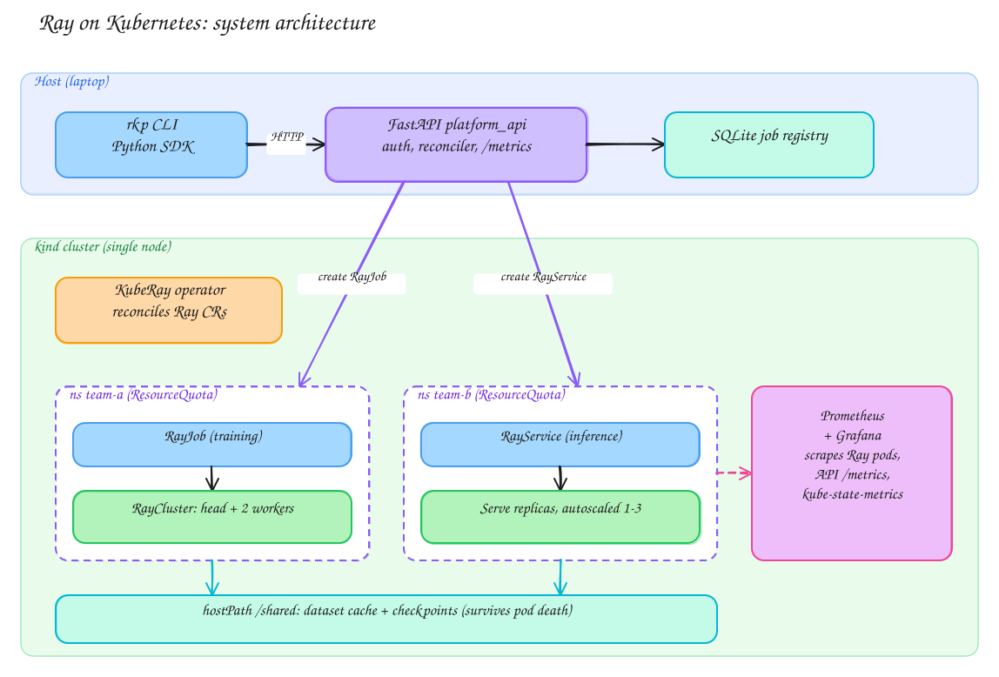
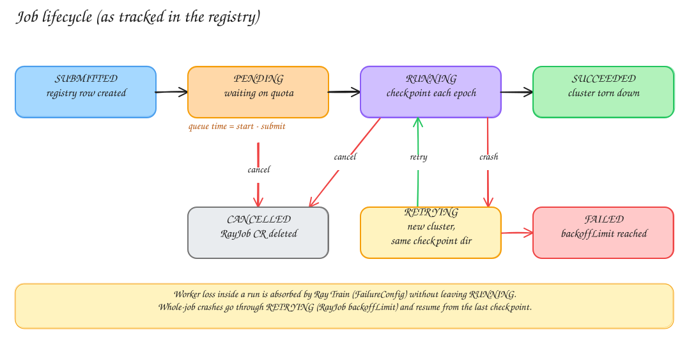
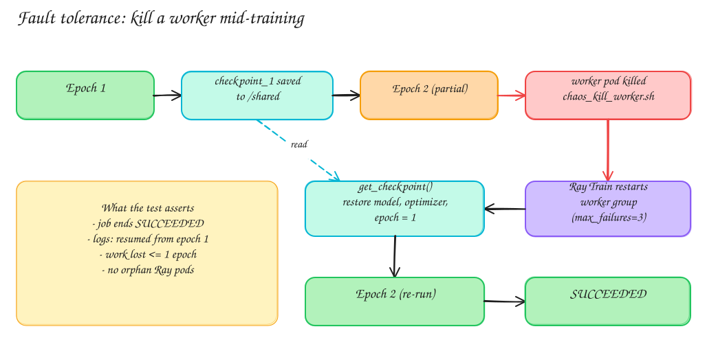
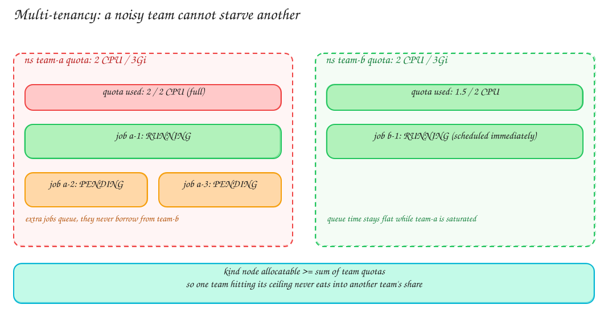

# Ray on Kubernetes: a self-service ML platform

[](https://github.com/Ridzzz0Alam/ray_on_kubernetes/actions/workflows/ci.yml)

> **Case study, rough draft.** The design is complete, but the build is in progress (Phase 0 of 9 done).
> Sections marked 🚧 describe the intended design. Their results will be filled in with real numbers once each
> phase ships. Live status: [PLAN.md](PLAN.md) · design detail: [ARCHITECTURE.md](ARCHITECTURE.md) ·
> session log: [PROGRESS.md](PROGRESS.md).

## TL;DR

Teams submit ML training or inference jobs through a small API (`rkp submit ...`). The platform runs each job
on Kubernetes with Ray, isolated in the team's own namespace. It checkpoints, survives worker crashes, retries
failures and scales inference with load. All of it runs on a **2-core, 15 GB, no-GPU laptop**.

| | |
|---|---|
| **Stack** | kind · KubeRay · Ray Train / Ray Serve · PyTorch · FastAPI · SQLite · Prometheus · Grafana · uv · GitHub Actions |
| **Core ideas** | one RayCluster per job, namespace-per-team quotas, checkpoint-first training, metrics from the job registry |
| **Constraint** | whole stack ≤ ~3 CPU / ~7 GB RAM |

---

## 1. The problem

ML teams that share a cluster usually hit the same problems:

1. **Friction.** Running distributed training means writing Kubernetes YAML and knowing Ray internals.
2. **Fragility.** A preempted or crashed worker throws away hours of training.
3. **Noisy neighbours.** One team's large sweep takes all the capacity and blocks everyone else.
4. **Opacity.** No one can say how long jobs waited, what they used or what they cost.

The goal: a **self-service platform** where a team hands over a script and some resource requirements, and the
platform takes care of scheduling, fault tolerance, isolation and visibility.

## 2. Goals and constraints

| Goal | How it's met |
|---|---|
| Self-service submission | FastAPI + Python SDK/CLI. Users never touch K8s YAML |
| Distributed training | Ray Train `TorchTrainer` across multiple workers |
| Survive failures | Per-epoch checkpoints, worker-level and job-level retries |
| Fair multi-tenancy | Namespace + `ResourceQuota` per team |
| Elastic inference | Ray Serve autoscaling on in-flight requests |
| Visibility and cost | Prometheus metrics, Grafana dashboard, cost-per-team report |
| GPU awareness | Ray custom resources simulate GPU scheduling locally |

**The hard constraint is the hardware:** an i7-7500U (2 cores / 4 threads), 15 GB RAM, no GPU. That shaped
many of the decisions (§9): a single-node cluster, one Ray cluster at a time, a tiny default model
(`bert-tiny`) and a stripped-down monitoring stack.

## 3. Architecture



| Component | Role |
|---|---|
| **`rkp` CLI / SDK** | Thin HTTP client: `submit`, `status`, `logs`, `cancel`, `list`, `cost` |
| **platform_api** (FastAPI) | Maps the API key to a team and namespace, builds Ray CRs from a validated `JobSpec`, serves `/metrics` |
| **Job registry** (SQLite) | Keeps job history after the CRs are deleted. It's the source for queue-time and cost metrics |
| **Reconciler** | Background loop that syncs RayJob status into the registry with timestamps |
| **KubeRay operator** | Turns `RayJob` / `RayService` CRs into Ray head and worker pods, and tears them down |
| **Team namespaces** | `team-a`, `team-b`, … each with a `ResourceQuota` + `LimitRange` |
| **`/shared` (hostPath)** | Dataset cache and checkpoints, which outlive any pod |
| **Prometheus + Grafana** | Ray metrics, API metrics, quota usage from kube-state-metrics |

Editable sources for all diagrams: [`docs/diagrams/*.excalidraw`](docs/diagrams/). Open them at
[excalidraw.com](https://excalidraw.com) or in the VS Code Excalidraw extension.

## 4. How a job flows

A real run of the Phase 2 smoke test:

```console
$ rkp submit --team team-a workloads/hello.py
0e639b3a
[    0s] SUBMITTED
[    2s] PENDING
[   42s] RUNNING
[   62s] SUCCEEDED  (Job finished successfully.)
$ rkp logs 0e639b3a | grep -v '^20'
task 0 ran on rkp-0e639b3a-vqh2s-cpu-worker-z8ngf
task 1 ran on rkp-0e639b3a-vqh2s-cpu-worker-27wsm
...
hello from rkp
$ rkp cancel <id>          # deletes the RayJob, state → CANCELLED
$ rkp status <id> -t team-b
error: HTTP 403: job <id> belongs to another team
```

Options: `--workers`, `--cpu`, `--memory`, `--retries`, `--no-wait`, and script arguments after `--`.
Most of the 42s in PENDING is pod start-up for the head and workers on 2 cores.

1. The CLI sends the spec to `POST /jobs` with the team's API key.
2. The API resolves the key to a team and namespace (never taken from the request body), validates the `JobSpec` and
   writes a `SUBMITTED` row.
3. The API creates a `RayJob` in `team-a`. KubeRay starts a RayCluster (head + workers), runs the entrypoint,
   then shuts the cluster down (`shutdownAfterJobFinishes`).
4. The reconciler records each state change. `queue time = started_at − submitted_at`, using Ray's own start time.
5. When the job ends, the reconciler copies the driver logs into SQLite and deletes the RayJob.
   Owner references remove the cluster, the submitter and the code ConfigMap.



## 5. Distributed training and fault tolerance 🚧

The training workload is a sentiment classifier on an Amazon reviews subset (about 4k train / 1k eval).
`TorchTrainer` runs 2 workers on the CPU `gloo` backend, with `torch.set_num_threads(1)` per worker so they
don't fight over 2 physical cores. The default model is `prajjwal1/bert-tiny` (about 4M params), and DistilBERT is opt-in.

Fault tolerance has two layers:

| Failure | Handled by | Effect |
|---|---|---|
| A worker pod dies mid-epoch | Ray Train `FailureConfig(max_failures=3)` | Worker group restarts, training resumes from the last checkpoint, and the job stays RUNNING |
| The whole job crashes | RayJob `backoffLimit` | New cluster, same `storage_path`, so it resumes from the checkpoint |
| A user cancels | API deletes the RayJob CR | The operator tears down all pods, and the state becomes CANCELLED |



The key detail is that the training loop always starts with `ray.train.get_checkpoint()` and restores the
model, **optimizer** and **epoch counter**, not just the weights. So a crash costs at most one epoch.

## 6. Multi-tenancy 🚧



- **Isolation:** every API call is scoped to the namespace of the caller's key, so team-b gets a 403 on team-a's jobs.
  When the API runs in-cluster, RBAC limits its ServiceAccount to `ray.io` resources in `team-*` namespaces.
- **No starvation:** each team has a hard `ResourceQuota`, and the node is sized so that the sum of the quotas is no more than
  allocatable. Team-a filling its quota leaves its extra jobs pending, and team-b is unaffected.
- **Demo:** `scripts/noisy_neighbour.sh` floods team-a, then submits one team-b job. It checks that team-b's job
  succeeds and its queue time stays flat.
- **Next step:** [Kueue](https://kueue.sigs.k8s.io/) for proper admission queues, fair sharing and preemption.

## 7. Inference with autoscaling 🚧

The trained model is served as a `RayService` (Ray Serve, `POST /predict`) with
`autoscaling_config: {min_replicas: 1, max_replicas: 3, target_ongoing_requests: 2}`.
`scripts/load_test.py` ramps from 1 to 20 concurrent clients and records the replica count and p50/p95 latency.

## 8. Observability and cost 🚧

| Metric | Source | Question it answers |
|---|---|---|
| `rkp_jobs_total{team,state}` | API | How many jobs succeed or fail per team? |
| `rkp_job_queue_seconds{team}` | API (registry timestamps) | Is a team starved? |
| `rkp_job_runtime_seconds{team}` | API | How long do jobs actually run? |
| `ray_node_cpu_utilization`, Serve QPS / replicas | Ray | Are workers busy, and is autoscaling working? |
| `kube_resourcequota{namespace}` | kube-state-metrics | How close is each team to its quota? |

**Cost report** (`rkp cost --since 7d`):
`cost = Σ runtime × (cpu × cpu_rate + mem_GB × mem_rate [+ gpu × gpu_rate])`, with rates in `config/rates.yaml`.

**GPU awareness:** a `gpu-sim` worker group advertises the Ray custom resource `sim_gpu`. Jobs that request it
wait for that group's capacity, while CPU jobs keep running. This exercises the scheduling logic with no hardware.
An optional run on a short-lived cloud GPU node uses the same job spec with `num_gpus=1`.

## 9. Key decisions and trade-offs

| Decision | Alternative | Why |
|---|---|---|
| **One RayCluster per job** (RayJob) | One long-lived shared Ray cluster | Clean isolation per team, per-job sizing, nothing idling. The cost is cluster start-up time per job |
| **API in front of K8s** | Give teams kubectl access | Enforces team scoping, hides YAML and keeps history |
| **SQLite registry** | Read state from CRs only | CRs are deleted after jobs finish, and queue time and cost need durable timestamps |
| **hostPath checkpoints** | MinIO / S3 | On a single node it's equivalent, and saves about 500 MB RAM. The production version would be S3 / GCS |
| **`bert-tiny` default** | DistilBERT | The platform mechanics are the point, and it keeps iteration under 10 min on 2 cores |
| **Pinned everything** | Latest tags | Reproducible builds. A test fails on any floating version |

## 10. Running it

**Prerequisites:** Linux/macOS, Docker, [uv](https://docs.astral.sh/uv/), about 8 GB free RAM.

```bash
git clone git@github.com:Ridzzz0Alam/ray_on_kubernetes.git && cd ray_on_kubernetes
make tools   # pinned kind / kubectl / helm → ~/.local/bin (sha256-verified)
make sync    # Python 3.12 env from uv.lock
make check   # lint + unit tests
```

Cluster + hello-world RayJob (Phase 1):

```bash
make image       # build the Ray runtime image (~3 min first time); kind-loads it if the cluster is up
make up          # single-node kind cluster + KubeRay operator; loads the image if built
make hello       # 2-worker RayJob → SUCCEEDED, RayCluster torn down 30s after
make down        # delete the cluster
```

API + CLI (Phase 2):

```bash
make teams       # team-a / team-b namespaces (quotas come in Phase 6)
make keys        # dev API keys → config/api_keys.yaml (server) + config/rkp.toml (CLI), git-ignored
make api         # platform API on 127.0.0.1:8000, in another terminal
uv run rkp submit --team team-a workloads/hello.py    # see §4
make test-k8s    # end-to-end submit / logs / cancel against kind (~2 min)
make down        # tear everything down
```

Pinned versions live in [`infra/versions.env`](infra/versions.env): kind v0.33.0 (K8s v1.37.0),
kubectl v1.37.2, Helm v4.3.1, KubeRay 1.7.2, Ray 2.59.0 (Python 3.12).

## 11. Testing strategy

| Layer | What | Where | Status |
|---|---|---|---|
| Static | ruff lint + format, shellcheck | `make lint`, CI | ✅ |
| Config guard | Every version pinned, node image pinned by digest | `tests/test_versions.py` | ✅ |
| Unit | JobSpec → RayJob manifest, auth and team scoping, reconciler, CLI (fake K8s client) | `make test` | ✅ |
| Integration | Submit / status / logs / cancel against kind | `make test-k8s` | ✅ |
| Chaos | Kill a worker mid-epoch, assert resume from checkpoint | `scripts/chaos_kill_worker.sh` | 🚧 |
| Tenancy | Noisy neighbour: team-b unaffected by team-a saturation | `scripts/noisy_neighbour.sh` | 🚧 |
| Load | Serve autoscaling 1 → 3 replicas under ramped load | `scripts/load_test.py` | 🚧 |

CI (GitHub Actions) runs the static and unit layers on every push. The cluster tests run locally, because a kind
cluster with Ray needs more than CI runners comfortably provide.

## 12. Results 🚧

These will be filled in from real runs. No numbers until they're measured.

| Measure | Result |
|---|---|
| Training time, `tiny`, 2 workers, 2 epochs | TBD |
| Eval accuracy | TBD |
| Work lost when a worker is killed mid-epoch | TBD (target: ≤ 1 epoch) |
| Team-b queue time while team-a is saturated | TBD |
| Serve replicas under load / p50 latency | TBD |
| Peak stack RAM | 4.5 GiB for the hello job via the API (head 2 Gi + 2 workers + kind + operator; it was 3.9 GiB in Phase 1 with a 1.5 Gi head); training TBD (budget: 7 GB) |

## 13. What production would change

S3/GCS checkpoints · OIDC instead of API keys · Postgres instead of SQLite · watch-based controller instead of
polling · Kueue with fair sharing and preemption · separate CPU/GPU/spot node pools on a managed cluster.
See [ARCHITECTURE.md §9](ARCHITECTURE.md#9-production-gaps-deliberately-not-built).

## 14. Repo layout

```
platform_api/   FastAPI service            ✅    infra/versions.env  pinned versions   ✅
sdk/            Python SDK + rkp CLI       ✅    infra/kind, k8s, helm  cluster, operator  ✅
workloads/      Ray Train + Ray Serve      🚧    scripts/            tools, diagrams   ✅
docs/diagrams/  Excalidraw sources + SVGs  ✅    tests/              pytest            ✅
```

## 15. Status

| Phase | | Phase | |
|---|---|---|---|
| 0 Bootstrap | ✅ | 5 Ray Serve | 🚧 |
| 1 Cluster + hello RayJob | ✅ | 6 Multi-tenancy | 🚧 |
| 2 API + SDK | ✅ | 7 Observability + cost | 🚧 |
| 3 Distributed training | 🚧 | 8 GPU awareness | 🚧 |
| 4 Lifecycle | 🚧 | 9 Polish + full case study | 🚧 |
