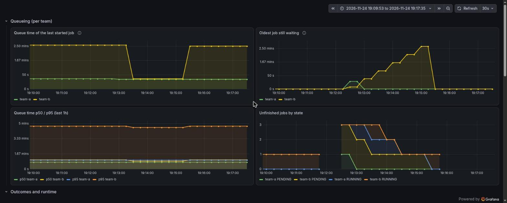
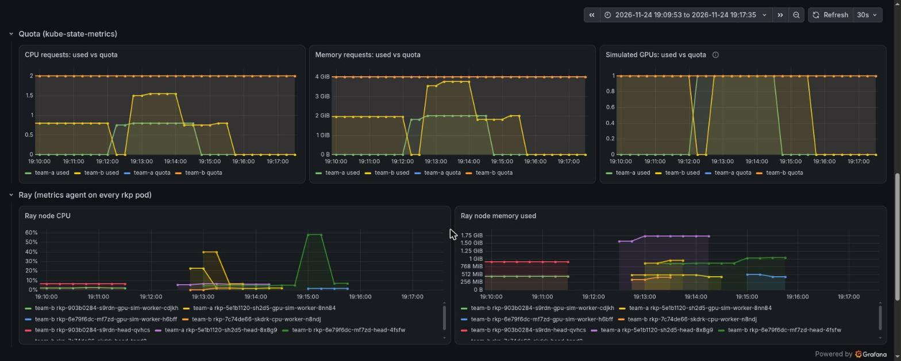
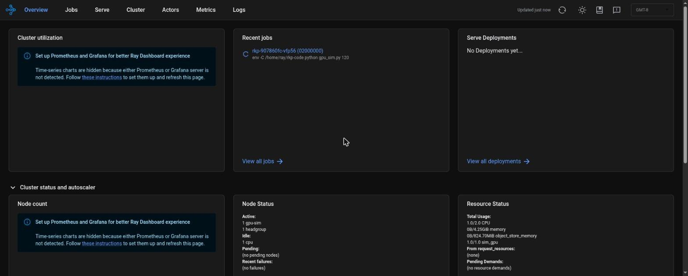
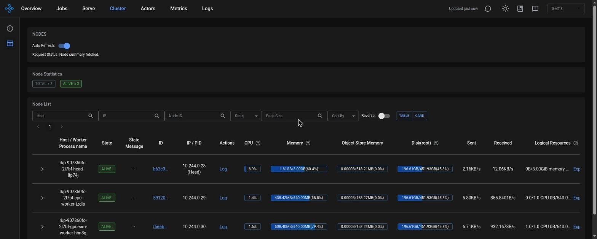

# Demo: GPU awareness (simulated GPUs)

The laptop has no GPU, so the platform simulates one the way a real cluster exposes GPUs. A GPU job **waits
Pending until the GPU frees up, while CPU jobs keep running**.

Recorded 2026-11-24 on the dev laptop (single-node kind, KubeRay 1.7.2, Ray 2.59.0).

## How it works

| Layer | What represents the GPU | Effect |
|---|---|---|
| Node | `example.com/gpu: 1` in the node's capacity (`make gpu-sim`, run by `make teams`) | This is what an NVIDIA device plugin does for `nvidia.com/gpu` |
| Pod | the gpu-sim worker requests and limits `example.com/gpu: 1` | The **scheduler** places at most one such pod. Others stay `Pending: Insufficient example.com/gpu` |
| Team quota | `requests.example.com/gpu: "1"` per team | The API's whole-job admission counts GPUs too. A team's 2nd GPU job is **QUEUED** in the API |
| Ray | the gpu-sim worker starts with `resources: {"sim_gpu": 1}` | Tasks and Train workers that request `sim_gpu` run only there |

- `JobSpec.gpus: 1` adds a `gpu-sim` worker group to the job's RayCluster (`workers` CPU workers stay in the `cpu`
  group, and can be 0). A job script asks for the GPU with `@ray.remote(resources={"sim_gpu": 1})` or, for Ray Train,
  `ScalingConfig(resources_per_worker={"CPU": 1, "sim_gpu": 1})` (`train.py --sim-gpu`).
- **GPUs are overcommitted across teams on purpose:** each team's quota allows 1, and the node has 1. Within a team,
  the API queues. Across teams, both jobs are admitted and the scheduler decides, the same as a real shared GPU pool.
- While a pod can't be scheduled, the reconciler copies the scheduler's reason into the job message:
  `waiting for scheduling: 0/1 nodes are available: 1 Insufficient example.com/gpu. …`. It's cleared once the job runs.

## Run it

```bash
make up && make teams && make keys     # make teams → make gpu-sim: node allocatable example.com/gpu: 1
make api                               # in another terminal
scripts/gpu_contention.sh 90
```

Sizes: team-b holds its GPU job and its CPU job at once inside a 4Gi requests quota, with each Ray head reserving
1536Mi. GPU jobs use 640Mi workers and the CPU job uses 512Mi (2056 + 1992 = 4048Mi ≤ 4096Mi).

## Output (snapshots)

```
== 19:11:53 team-a: GPU job (holds the GPU ~90s)
== 19:12:14 team-b: GPU job (30s) + CPU job
== +0s
rkp-5e1b1120-sh2d5-gpu-sim-worker-8nn84   team-a   Running
rkp-6e79f6dc-mf7zd-gpu-sim-worker-h6bff   team-b   Pending
  TEAM    ID        STATE      QUEUED   RAN  MESSAGE
  team-a  5e1b1120  PENDING         -     -
  team-b  6e79f6dc  PENDING         -     -  waiting for scheduling: 0/1 nodes are available: 1 Insufficient example.com/gpu. …
  team-b  7c74de66  PENDING         -     -
== +85s
rkp-5e1b1120-sh2d5-gpu-sim-worker-8nn84   team-a   Running
rkp-6e79f6dc-mf7zd-gpu-sim-worker-h6bff   team-b   Pending
  team-a  5e1b1120  RUNNING       34s     -
  team-b  6e79f6dc  PENDING         -     -  waiting for scheduling: 0/1 nodes are available: 1 Insufficient example.com/gpu. …
  team-b  7c74de66  SUCCEEDED     36s   36s  Job finished successfully.        ← CPU job not blocked
== +167s
rkp-6e79f6dc-mf7zd-gpu-sim-worker-h6bff   team-b   Running                     ← got the GPU when team-a's job ended
  team-a  5e1b1120  SUCCEEDED     34s   95s  Job finished successfully.
  team-b  6e79f6dc  RUNNING      150s     -
== +199s
  team-a  5e1b1120  SUCCEEDED     34s   95s  Job finished successfully.
  team-b  6e79f6dc  SUCCEEDED    150s   35s  Job finished successfully.
  team-b  7c74de66  SUCCEEDED     36s   36s  Job finished successfully.

== team-b 6e79f6dc: where the GPU steps ran
  cluster resources: {..., 'CPU': 1.0, 'sim_gpu': 1.0, ...}
  gpu step 1/6 ran on rkp-6e79f6dc-mf7zd-gpu-sim-worker-h6bff after 6s
```

**Result:** team-b's GPU job waited **150s** for the GPU (about team-a's 95s run plus cluster start-up), then ran in 35s.
Team-b's CPU job, submitted at the same moment, finished in **36s**, the same as on an idle cluster. Every `sim_gpu`
task ran on the gpu-sim worker.

The Ray job stays PENDING for the whole wait: KubeRay only submits the driver once every pod in the cluster is ready,
so no Ray task ever sits waiting on a missing resource. For a few seconds after the pod is scheduled (+134s) the job
still shows the old reason, until KubeRay reports the cluster ready and the job moves to RUNNING.

### Within one team: queued in the API

A team's second GPU job doesn't reach Kubernetes. The API queues it with
`waiting for quota: needs … / 1 GPU, team-a uses … / 1 GPU of 2 CPU / 4096Mi / 1 GPU`. A CPU job submitted
behind it waits too, because the queue is FIFO and nothing jumps it. Both cases are unit-tested in `tests/test_gpu.py`.

## Screenshots

Grafana over the demo window: team-b's "Oldest job still waiting" climbs to about 2.6 min, then drops when it gets the GPU.



Quota panels: both teams show **1/1 GPU used** while team-b's pod is still Pending. The quota admitted it, and the
node's single GPU is what held it back.



Ray dashboard of a running GPU job (1 CPU worker + 1 gpu-sim worker): `1.0/1.0 sim_gpu` in use, the gpu-sim node
active and the CPU node idle.




## What went wrong first

The first run used 512Mi for every worker. Team-b's gpu-sim worker never finished: on that node, Ray's own processes
(`ray start`, raylet, dashboard and runtime-env agents) used about 0.45 GB of the 512Mi, so Ray's memory monitor
killed the `gpu_step` task for memory pressure and kept retrying it. The job showed RUNNING indefinitely until it was
cancelled. **512Mi is too small for a Ray worker that runs tasks.** The demo uses 640Mi for GPU workers.

## Memory

Three small Ray clusters at once (team-a GPU, team-b GPU waiting, team-b CPU) is the heaviest scenario so far:

| Run | Node peak (excluding page cache) |
|---|---|
| Recorded demo, monitoring on | ~6.5 GiB |
| Same scenario in the full `make test-k8s`, monitoring off | 7.65 GiB (over the 7 GB budget) |
| **After `--no-monitor` on the Ray heads:** `scripts/gpu_contention.sh 90`, monitoring off | **5.71 GiB** |
| **After `--no-monitor`:** full `make test-k8s` (17/17), monitoring off | **6.84 GiB** |

The cost was the Ray heads: ~1.4 GB of private memory each, even for tiny jobs. Measured per process, the
biggest unused one was the autoscaler monitor (~115 MB), which does nothing with fixed-size worker groups, so heads
now start with `--no-monitor`. The Ray Client server (~112 MB) is just as unused, but `ray start` rejects port 0, and
trimming dashboard modules would mean patching the image's start command, so both stay.

## Ray Train on the simulated GPU

`train.py --sim-gpu` puts `sim_gpu` in Ray Train's `resources_per_worker`. Submitted as a GPU job with no CPU workers:

```
$ uv run rkp submit --team team-a --no-wait --workers 0 --gpus 1 --memory 1536Mi workloads/train --script train.py \
      -- --profile tiny --epochs 1 --workers 1 --sim-gpu
[   40s] RUNNING
[  110s] SUCCEEDED  (Job finished successfully.)
(TrainController) Requesting resources: {'CPU': 1, 'sim_gpu': 1} * 1
(TrainController) Started training worker group of size 1
(RayTrainWorker)  [rank 0] {'epoch': 1, 'train_loss': 0.4865, 'eval_loss': 0.347, 'eval_accuracy': 0.846, 'epoch_seconds': 43.9}
```

## Cloud GPU (not done)

PLAN.md's optional step runs the same job on a short-lived cloud GPU node (about $2–5). It needs the owner's approval at the
time (AGENTS.md §4) and wasn't run. The job spec would carry over: the device plugin exposes `nvidia.com/gpu` instead of
`example.com/gpu`, and Ray's built-in `GPU` resource replaces `sim_gpu`.
