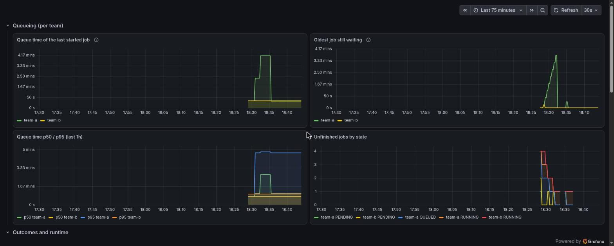
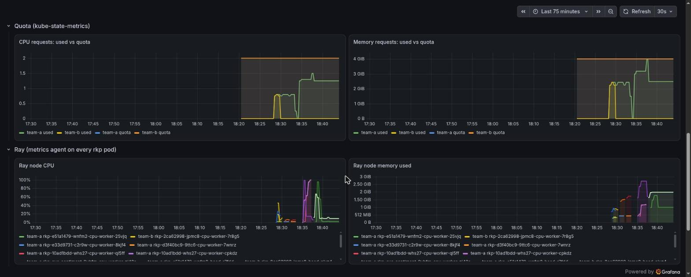

# Demo: observability and cost

The Phase 6 noisy-neighbour demo, replayed with Prometheus and Grafana running. The dashboard shows team-a's queue
time going up while team-b's stays flat. `rkp cost` then reports usage and cost per team.

Recorded 2026-11-24 on the dev laptop (single-node kind, Prometheus v3.16.0 via chart 29.47.0, Grafana 13.3.1 via
grafana-community chart 14.4.1).

## How it fits together

```
make api (host)  ── 127.0.0.1:8000   REST API for the CLI/SDK (incl. GET /metrics, GET /cost)
                 └─ 172.18.0.1:9108  metrics-only listener on the kind network gateway ◄── Prometheus scrapes
Prometheus (ns monitoring) ── kube-state-metrics (quota used / hard)
                           └─ Ray metrics agent (port "metrics", 8080) on every rkp head/worker pod in team-*
Grafana ── dashboards/rkp.json (provisioned by `make monitoring`)
```

- The API metrics are **computed from the registry at scrape time** ([`platform_api/metrics.py`](../../platform_api/metrics.py)),
  so they survive API restarts and agree with `rkp list`:
  `rkp_jobs_total{team,state}` (finished), `rkp_jobs_active{team,state}`, `rkp_job_queue_seconds` and
  `rkp_job_runtime_seconds` (histograms), `rkp_job_last_queue_seconds`, `rkp_job_oldest_waiting_seconds` and `rkp_services_live`.
- The API stays on `127.0.0.1`. The second listener binds only the kind bridge address, so pods can reach it but the LAN can't.
- Prometheus is minimal: server and kube-state-metrics (3 collectors) only, 30s scrapes, 6h retention, and no persisted data.
  The chart's default jobs (cadvisor, nodes, apiserver and so on) are switched off.
- Images are pulled once and kind-loaded (`pullPolicy: Never`). Nothing is pulled at pod start.

## Run it

```bash
make up && make teams && make keys
make monitoring          # ~1 min once images are cached; `make monitoring-down` frees the memory again
make api                 # in another terminal (adds RKP_METRICS_ADDR=<kind gateway>:9108)
scripts/noisy_neighbour.sh 3 60
make grafana             # http://127.0.0.1:3000/d/rkp  (anonymous viewer)
uv run rkp cost --since 24h
```

## Result

Prometheus `rkp_job_last_queue_seconds`, sampled every 30s across the 320s run:

```
team-a  34 34 34 34 141 141 141 246 246 246
team-b  33 33 33 33  33  33  33  33  33  33
```

`rkp_job_oldest_waiting_seconds` for team-a climbed `0 14 43 73 103 133 163 193 223` while its jobs queued, then dropped to 0.
team-b's only went above zero for its own 12s start-up.



"Queue time of the last started job": **team-a (green) steps up to about 4 min while team-b (yellow) stays flat at about 33s.**
"Oldest job still waiting" shows team-a's queue building and draining. "Unfinished jobs by state" shows team-a's 3
jobs, 2 of them QUEUED, while team-b's single job runs.



The quota panels show each team at one 1-worker job's worth of requests (0.8 CPU / 2.45 GiB) during the demo. The later
team-a block is a 2-epoch training job, then a served model.

### Cost

```
$ uv run rkp cost --since 24h
usage over the last 24h (requests x time; rates from config/rates.yaml)
TEAM        JOBS  SVCS  CPU-HOURS   GB-HOURS       COST
team-a         4     1      0.231      0.524     0.0066 USD
team-b         1     0      0.008      0.025     0.0002 USD
total                       0.239      0.548     0.0068 USD
```

Billing is pod **requests × time held**: a job from Ray driver start to finish, a service from creation to deletion.
Queued jobs cost nothing. As a check, team-b's one job ran 36s with 0.8 CPU / 2504Mi of requests:
0.8 × 36/3600 = 0.008 CPU-hours, and 2504/1024 × 0.01 h = 0.0245 GB-hours. Rates are in
[`config/rates.yaml`](../../config/rates.yaml) (GCP e2 on-demand list prices as a reference point). The arithmetic is
unit-tested against registry rows with fixed timestamps in [`tests/test_cost_metrics.py`](../../tests/test_cost_metrics.py).

## Memory (excluding page cache)

| Situation | Node peak |
|---|---|
| Cluster + monitoring, no Ray pods | 1.74 GiB |
| Monitoring stack alone, idle (Grafana 236 MB, Prometheus 43 MB, kube-state-metrics 14 MB) | ~0.3 GB |
| Noisy-neighbour demo (2 Ray clusters) + monitoring | 4.53 GiB |
| 2-epoch `tiny` training + monitoring | **7.01 GiB**, against the 7 GB budget (6.9 GiB without monitoring) |

Training with monitoring on sits right at the budget. Run `make monitoring-down` before long training runs.

## Two things the dashboard showed

- **Serve replicas:** summing `ray_serve_deployment_replica_healthy` undercounted (it peaked at 1 while 3 replicas ran), because
  each short-lived replica is its own series, scraped at different times. The panel uses
  `ray_serve_autoscaling_target_replicas`, which read `1 1 3 3 3 3 1 1 1` across the load test.
- **Quota hand-over gap:** team-a's memory "used" touched the 4 GiB ceiling when a service was created right after a
  training job finished. The API had released the job's quota as soon as the RayJob was deleted, but its pods were still
  terminating, and Kubernetes counts terminating pods. The ResourceQuota backstop held the new pods back briefly, and
  the service still came up. **Fixed after Phase 8:** the admitter now also counts the pods of finished jobs and deleted
  services until they're gone (same rule as the quota: a pod stops counting once it has finished or its deletion grace
  period is over). The noisy-neighbour e2e test checks that the queued job gets no `exceeded quota` events.
